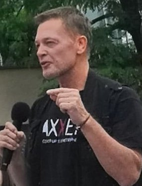

# Andrew Wakefield (born 1956)

**Prerequisites:** none; see the linked lessons for context.

*Andrew Wakefield speaking at a march organised by the Polish vaccine-critical group STOP NOP in Warsaw, 2019. Credit: Bladość. License: [CC BY-SA 4.0](https://creativecommons.org/licenses/by-sa/4.0). Source: [File:Andrew Wakefield 2019 (cropped).jpg](https://commons.wikimedia.org/wiki/File:Andrew_Wakefield_2019_%28cropped%29.jpg).*

## Who he is

Andrew Wakefield is a British former gastroenterologist and surgeon. While at the Royal Free Hospital in London he became the central figure in the controversy over MMR vaccine and autism.

## The 1998 paper

In February 1998, Wakefield and 12 co-authors published a case series in *The Lancet* describing 12 children with bowel symptoms and developmental regression, eight of whom, according to their parents or doctors, developed symptoms soon after MMR vaccination ([Wakefield et al., *Lancet* 1998 (retracted)](https://doi.org/10.1016/S0140-6736(97)11096-0)). The paper said it did not prove a link, but at a press conference Wakefield called for MMR to be replaced with single vaccines. MMR uptake in the UK fell, and measles returned ([MMR and autism](../07-controversies/01-mmr-and-autism.md)).

## Investigation and downfall

Investigations by the journalist Brian Deer, beginning in 2004, found that Wakefield had been paid by lawyers preparing a lawsuit against MMR manufacturers, funded by the Legal Aid Board, and had filed a patent application for a rival single measles vaccine, neither of which was disclosed in the paper ([Deer, *BMJ* 2011, "How the vaccine crisis was meant to make money"](https://doi.org/10.1136/bmj.c5258)). Ten of the co-authors retracted the paper's interpretation in 2004. Deer later reported that the children's records did not match what was published ([Deer, *BMJ* 2011, "How the case against the MMR vaccine was fixed"](https://doi.org/10.1136/bmj.c5347)), and *The BMJ*'s editors called the paper fraudulent ([Godlee, Smith & Marcovitch, *BMJ* 2011 editorial](https://doi.org/10.1136/bmj.c7452)).

In January 2010 the UK's General Medical Council found that Wakefield had acted dishonestly and irresponsibly, including by subjecting children to invasive tests without proper ethical approval ([General Medical Council, Fitness to Practise Panel findings on Wakefield, Walker-Smith and Murch (January 2010), as reported by *The BMJ*](https://doi.org/10.1136/bmj.c593)). *The Lancet* fully retracted the paper in February 2010 ([*Lancet* retraction notice, 2010](https://doi.org/10.1016/S0140-6736(10)60175-4)), and in May 2010 Wakefield was struck off the medical register. A co-author, John Walker-Smith, won an appeal against his own striking-off in 2012, the court finding that the GMC panel had erred in his case.

## Later activities

Wakefield moved to the United States, where he worked at an autism treatment centre in Texas and then as an activist. He directed the 2016 film *Vaxxed*, about the CDC whistleblower claims ([CDC whistleblower claims](../07-controversies/04-cdc-whistleblower-claims.md)), and has spoken widely at vaccine-critical events. He denies any wrongdoing and describes himself as the target of a campaign by the pharmaceutical industry and government, setting out his case in *Callous Disregard* (2010).

## Assessment

Large studies in many countries have found no link between MMR and autism, and his findings have never been replicated ([Hviid et al., *Annals of Internal Medicine* 2019](https://doi.org/10.7326/M18-2101)). Supporters see him as a whistleblower punished for raising questions; most scientists regard the episode as a case of fraud with lasting public-health harm. It is a standard case study in research ethics ([Wakefield case study](../../../../science/research-methods/reading-research/10-case-studies/07-wakefield-1998.md)).

## Key ideas

- Wakefield's 1998 *Lancet* paper suggested an MMR link to autism and bowel disease, fuelling a collapse in MMR uptake.
- Undisclosed legal funding, a rival patent and misreported data led to retraction and his striking-off in 2010.
- He continues as an activist and denies wrongdoing; his findings have never been replicated.

## Where this leads

- [Barbara Loe Fisher](barbara-loe-fisher.md), founder of the leading US vaccine-safety advocacy group.
