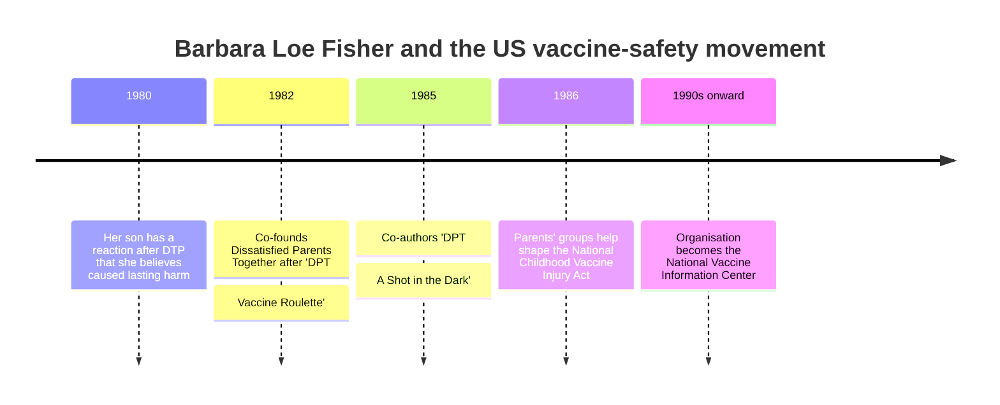

# Barbara Loe Fisher

**Prerequisites:** none; see the linked lessons for context.

## Who she is

Barbara Loe Fisher is an American writer and activist, co-founder and longtime president of the National Vaccine Information Center (NVIC), one of the oldest and most influential vaccine-safety advocacy groups in the US. She describes her organisation as supporting informed consent and vaccine choice rather than opposing vaccination; critics describe it as anti-vaccine.

## Origins

Fisher has written that her son Chris had a severe reaction to a DTP vaccination in 1980 and later developed learning disabilities and attention problems, which she attributes to the vaccine. After the 1982 documentary *DPT: Vaccine Roulette*, she and other parents founded Dissatisfied Parents Together. With Harris Coulter she co-wrote *DPT: A Shot in the Dark* (1985), arguing that whole-cell pertussis vaccine caused brain damage and that the risks had been played down ([DTP and whole-cell pertussis](../07-controversies/08-dtp-and-whole-cell-pertussis.md)).

## The 1986 Act

Parents' groups including hers took part in negotiations over the National Childhood Vaccine Injury Act of 1986. They pushed for provisions on safety reporting, record-keeping and information for parents before vaccination, which became law alongside the compensation program ([the 1986 Act](../08-litigation-and-compensation/02-the-national-childhood-vaccine-injury-act-1986.md)). Fisher has since argued that the law's liability protections removed manufacturers' incentives to make safer vaccines, and that the compensation program became adversarial.

## Later advocacy

The NVIC campaigns for non-medical exemptions, publicises vaccine adverse-event reports, and opposes mandates. It has been criticised by public-health officials and researchers for promoting claims about vaccines and autism and other harms that large studies have not supported, and for presenting VAERS reports as evidence of causation ([reading VAERS correctly](../02-development-and-regulation/08-reading-vaers-correctly.md)). Supporters credit it with keeping vaccine injuries on the agenda and with pushing for the switch to safer acellular pertussis vaccines, which did happen in the 1990s.

## Why she matters

Fisher's story shows that the modern US vaccine-safety movement began with a real scientific controversy over a genuinely reactogenic vaccine, and that its founders helped shape the laws that govern vaccines today. Her organisation's history also overlaps with every later controversy in this course, from thimerosal to COVID-19 mandates. Whether one sees the NVIC as a watchdog or a source of misinformation depends partly on which of its claims one examines.

## Key ideas

- Fisher co-founded Dissatisfied Parents Together, which became the National Vaccine Information Center.
- Her advocacy began with the whole-cell DTP controversy and helped shape the 1986 Act.
- The NVIC promotes vaccine choice; critics say it spreads unsupported claims of harm.

## Where this leads

- [Robert F. Kennedy Jr.](robert-f-kennedy-jr.md), who brought vaccine scepticism into government.
