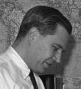

# D. A. Henderson (1928–2016)

**Prerequisites:** none; see the linked lessons for context.

*Donald A. Henderson in 1966, when he became director of the WHO smallpox eradication programme. Credit: CDC/ Dr. John J. Witte. License: Public domain. Source: [File:Donald A. Henderson (cropped).jpg](https://commons.wikimedia.org/wiki/File:Donald_A._Henderson_%28cropped%29.jpg).*

## Who he was

Donald Ainslie Henderson, known as D. A. Henderson, was an American epidemiologist who directed the World Health Organization's Intensified Smallpox Eradication Programme from 1966 to 1977, leading the only successful eradication of a human disease ([smallpox eradication](../04-history/07-smallpox-eradication.md)).

## The eradication campaign

When the campaign began in 1967, smallpox was endemic in more than 30 countries and caused millions of cases a year. Henderson, who had worked at the CDC, led a small WHO team coordinating national programmes. The campaign's key innovation was **surveillance and containment**, also called ring vaccination: rather than trying to vaccinate everyone, teams found cases quickly and vaccinated their contacts and surrounding communities, cutting chains of transmission. The bifurcated needle and freeze-dried vaccine made vaccination easier in hot climates. Thousands of national health workers, not WHO staff, did most of the work, and the campaign cost far less than the annual cost of smallpox vaccination and quarantine in rich countries.

The last natural case of the major form of smallpox occurred in Bangladesh in 1975, and the last natural case of any smallpox in Somalia in 1977. WHO certified eradication in 1980 ([WHO smallpox health topic](https://www.who.int/health-topics/smallpox)).

## Later career

Henderson was dean of the Johns Hopkins School of Public Health from 1977 to 1990, worked in the US government on science policy, and after the 2001 anthrax attacks led federal efforts on bioterrorism preparedness, including smallpox vaccine stockpiles. He received the Presidential Medal of Freedom in 2002, wrote his own account of the campaign, *Smallpox: The Death of a Disease* (2009), and died in 2016 at the age of 87.

## A sceptic of eradication

Unusually for an eradication pioneer, Henderson was sceptical of later eradication campaigns, arguing that smallpox had special features that made it eradicable and that resources might be better spent on strengthening routine immunisation and health systems. His view is part of the debate described in [eradication and elimination](../09-public-health-and-ethics/01-eradication-and-elimination.md).

## Ethics of the campaign

Historians have noted that in its final stages, especially in India and Bangladesh, the campaign sometimes used forcible vaccination and house searches. Henderson and colleagues defended the overall approach as necessary to end a disease that killed hundreds of millions in the 20th century; critics argue it shows how eradication's urgency can override consent.

## Key ideas

- Henderson led WHO's smallpox eradication programme from 1966 to 1977.
- Surveillance and ring vaccination, not mass vaccination alone, were key to success.
- He later doubted that other diseases could be eradicated the same way.

## Where this leads

- Back to the [people index](README.md) or the [history section](../04-history/README.md).
