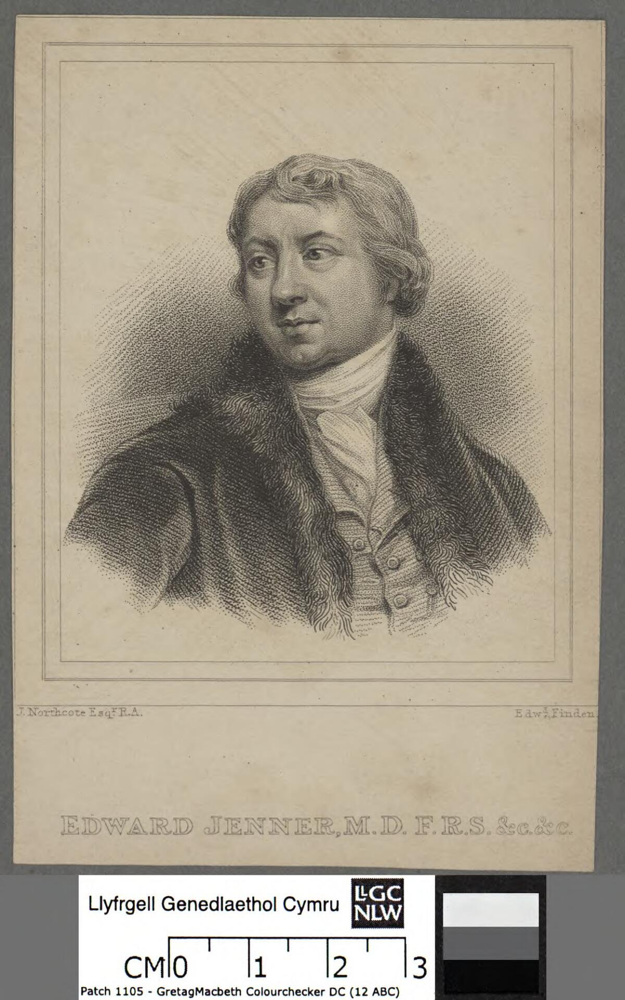

# Edward Jenner (1749–1823)

**Prerequisites:** none; see the linked history lessons for context.

*Portrait of Edward Jenner, from the Welsh Portrait Collection at the National Library of Wales. Credit: Edward Francis Finden. License: Public domain. Source: [File:Portrait of Edward Jenner, M.D., F.R.S. .(4673324).jpg](https://commons.wikimedia.org/wiki/File:Portrait_of_Edward_Jenner,_M.D.,_F.R.S._.%284673324%29.jpg).*

## Who he was

Edward Jenner was an English country doctor in Berkeley, Gloucestershire, trained in London under the surgeon John Hunter. He is known as the founder of vaccination, although others had tried similar ideas before him.

## The cowpox experiment

Country people believed that milkmaids who caught cowpox, a mild disease of cows' udders, were protected from smallpox. Jenner tested the idea in May 1796. He took material from a cowpox sore on the hand of a milkmaid, Sarah Nelmes, and inoculated James Phipps, the eight-year-old son of his gardener. Weeks later he inoculated the boy with smallpox matter, a common practice at the time called variolation, and Phipps did not develop the disease. In 1798 Jenner published *An Inquiry into the Causes and Effects of the Variolae Vaccinae*, describing this and other cases. The word "vaccine" comes from *vacca*, Latin for cow ([Jenner and cowpox](../04-history/02-jenner-and-cowpox.md)).

## Precursors and credit

Jenner was not the first to use cowpox. A Dorset farmer, Benjamin Jesty, had inoculated his family with cowpox in 1774, and variolation with smallpox material had been practised for centuries in Asia, Africa and the Middle East, and in Britain from the 1720s ([variolation](../04-history/01-variolation.md)). Jenner's contribution was to test the idea, publish it, and promote it relentlessly. Parliament awarded him £10,000 in 1802 and £20,000 in 1807.

## Controversy then and now

Vaccination spread rapidly across Europe and the Americas, but faced opposition from the start: religious objections to using animal material, cartoons of people sprouting cow features, and doubts about whether protection lasted. Jenner initially claimed lifelong protection, which proved wrong; revaccination became necessary. Nineteenth-century critics argued that vaccine lymph could transmit other diseases such as syphilis, which did sometimes happen with arm-to-arm vaccination ([compulsory vaccination](../04-history/03-compulsory-vaccination-and-the-anti-vaccination-leagues.md)). Modern ethicists note that experimenting on a child with smallpox would be unacceptable today.

Later research showed that the vaccinia virus used in smallpox vaccines in the 20th century is not identical to cowpox virus, and its origins remain debated.

## Legacy

Smallpox was eradicated in 1980, 184 years after Jenner's experiment ([smallpox eradication](../04-history/07-smallpox-eradication.md)). Jenner is often presented as a heroic pioneer; historians stress that his work built on folk knowledge and variolation, and that his success depended on the many doctors and governments that spread vaccination.

## Key ideas

- Jenner showed in 1796 that cowpox inoculation protected against smallpox, and published it in 1798.
- Others had used cowpox and variolation before him; his role was to test and promote vaccination.
- His claims of lifelong protection were wrong, and opposition to vaccination began in his lifetime.

## Where this leads

- [Louis Pasteur](louis-pasteur.md), who extended the idea of vaccines to other diseases.
