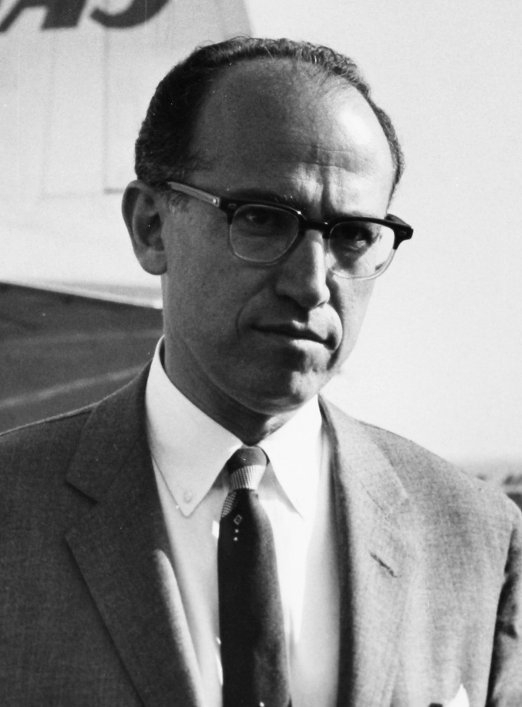

# Jonas Salk (1914–1995)

**Prerequisites:** none; see the linked history lessons for context.

*Jonas Salk, creator of the inactivated polio vaccine, at Copenhagen Airport. Credit: SAS Scandinavian Airlines. License: Public domain. Source: [File:Jonas Salk candid.jpg](https://commons.wikimedia.org/wiki/File:Jonas_Salk_candid.jpg).*

## Who he was

Jonas Salk was an American virologist who developed the first effective polio vaccine. Before that, he had worked on influenza vaccines with Thomas Francis at the University of Michigan.

## The inactivated polio vaccine

At the University of Pittsburgh, with funding from the National Foundation for Infantile Paralysis (the March of Dimes), Salk developed a vaccine made from poliovirus grown in monkey kidney cells and killed with formaldehyde. In 1954 it was tested in one of the largest field trials in history, run independently by Thomas Francis, involving about 1.8 million children, the "Polio Pioneers". On 12 April 1955, Francis announced that the vaccine was safe and effective, and it was licensed the same day ([Salk, Sabin and the Cutter incident](../04-history/06-salk-sabin-and-the-cutter-incident.md)).

Asked by the journalist Edward R. Murrow who owned the patent, Salk replied: "Well, the people, I would say. There is no patent. Could you patent the sun?"

## The Cutter incident

Within weeks, some batches made by Cutter Laboratories turned out to contain live virus because inactivation had failed. Tens of thousands of children developed mild polio, about 200 were paralysed and 10 died, many of them family contacts of vaccinated children ([Nathanson & Langmuir, *American Journal of Hygiene* 1963](https://doi.org/10.1093/oxfordjournals.aje.a120328)). The disaster led to stronger federal regulation of vaccines and, through a later court case finding Cutter liable without negligence, shaped the liability problems that culminated in the 1986 Act ([the 1980s DTP lawsuits](../08-litigation-and-compensation/01-the-1980s-dtp-lawsuits.md)).

## Criticism

Salk's early tests were carried out on children in institutions, including a home for disabled children near Pittsburgh, with consent from parents or institutions, under standards that would not be acceptable today. Some scientists, notably Albert Sabin, criticised him for publicity seeking and argued that a live vaccine would be better. Salk was never elected to the US National Academy of Sciences.

## Legacy

US polio cases fell from tens of thousands a year to a few hundred within a few years. The oral vaccine largely replaced Salk's in the 1960s, but improved inactivated vaccines came back: the US switched entirely to them in 2000, and they are central to the polio endgame ([polio eradication](../04-history/08-polio-eradication.md)). Salk founded the Salk Institute for Biological Studies in California, which opened in the 1960s.

## Key ideas

- Salk's formaldehyde-inactivated vaccine was proven in a 1954 trial of 1.8 million children and licensed in 1955.
- The Cutter incident, from faulty manufacturing, paralysed about 200 people and transformed regulation.
- He did not patent the vaccine; early tests on institutionalised children are now viewed critically.

## Where this leads

- [Albert Sabin](albert-sabin.md), his rival.
