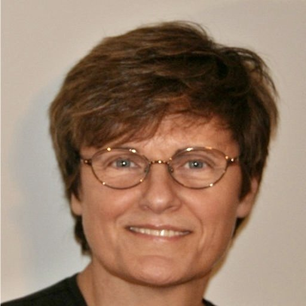

# Katalin Karikó (born 1955)

**Prerequisites:** none; see the linked lessons for context.

*Katalin Karikó, Hungarian-American biochemist. Credit: File:Katalin Kariko.jpg: Krdobyns derivative work: Innisfree987. License: [CC BY-SA 4.0](https://creativecommons.org/licenses/by-sa/4.0). Source: [File:Katalin Kariko light corrected.jpeg](https://commons.wikimedia.org/wiki/File:Katalin_Kariko_light_corrected.jpeg).*

## Who she is

Katalin Karikó is a Hungarian-American biochemist whose work on modified messenger RNA made mRNA vaccines possible. She shared the 2023 Nobel Prize in Physiology or Medicine with her long-time collaborator Drew Weissman ([Nobel Prize in Physiology or Medicine 2023, press release](https://www.nobelprize.org/prizes/medicine/2023/press-release/)).

## Persistence

Karikó trained in Hungary and moved to the United States in 1985. Through the 1990s she pursued the idea of using mRNA as a therapy at the University of Pennsylvania, despite repeated grant rejections; in 1995 she was demoted from her faculty track. The central problem was that injected mRNA triggered strong inflammatory reactions and was quickly destroyed.

## The key discovery

Working with Weissman, an immunologist, Karikó found that RNA made in the laboratory activated immune sensors called Toll-like receptors, while RNA from mammalian cells, which contains chemically modified nucleosides, did not. In a 2005 paper they showed that replacing uridine with modified forms such as pseudouridine greatly reduced the inflammatory response ([Karikó et al., *Immunity* 2005](https://doi.org/10.1016/j.immuni.2005.06.008)). Later work showed that modified mRNA also produced much more protein. These findings were initially little noticed. Weissman and Karikó founded a small company to develop the technology, and Penn licensed the patents; the rights later passed, through sublicences, to companies including BioNTech and Moderna. Another problem remained: naked mRNA is fragile and cannot easily enter cells. Lipid nanoparticles, developed by other researchers including Pieter Cullis's group in Canada, solved delivery.

## From lab to pandemic

Karikó joined the German company BioNTech in 2013. When COVID-19 emerged, BioNTech with Pfizer and, separately, Moderna used nucleoside-modified mRNA to produce vaccines within a year, building on decades of work by many researchers on mRNA, lipid nanoparticles and stabilised spike proteins ([mRNA vaccines](../01-how-vaccines-work/09-mrna-vaccines.md); [COVID-19 vaccines](../04-history/13-covid-19-vaccines-and-operation-warp-speed.md)).

## Debates

Karikó's story is often told as one of a neglected scientist vindicated, and is used to criticise academic funding systems. Vaccine critics who distrust mRNA vaccines sometimes point to the speed of their development and their novelty; supporters point out that the underlying science took more than 30 years. The patents arising from her and Weissman's work at Penn have been the subject of licensing disputes between companies, and she has received substantial royalties and prizes.

## Key ideas

- Karikó and Weissman showed in 2005 that modified nucleosides make mRNA far less inflammatory.
- This underlies the Pfizer-BioNTech and Moderna COVID-19 vaccines.
- She shared the 2023 Nobel Prize after decades of limited support.

## Where this leads

- [D. A. Henderson](d-a-henderson.md), who led the eradication of smallpox.
