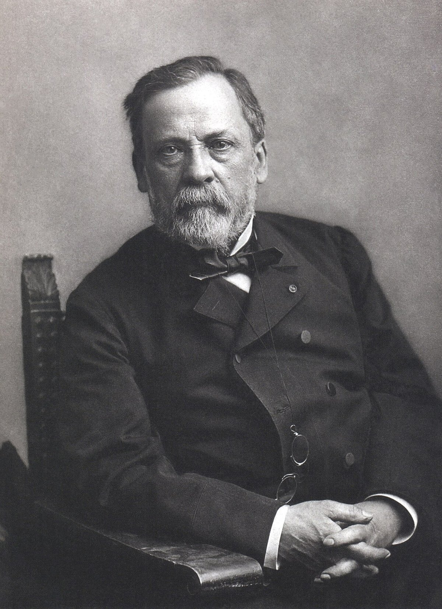

# Louis Pasteur (1822–1895)

**Prerequisites:** none; see the linked history lessons for context.

*Louis Pasteur, photographed by Paul Nadar. Credit: Paul Nadar. License: Public domain. Source: [File:Louis Pasteur, foto av Paul Nadar, Crisco edit.jpg](https://commons.wikimedia.org/wiki/File:Louis_Pasteur,_foto_av_Paul_Nadar,_Crisco_edit.jpg).*

## Who he was

Louis Pasteur was a French chemist whose work on fermentation, microbes and disease helped establish germ theory. He coined the general use of "vaccine" for any attenuated pathogen used to induce immunity, in honour of Jenner.

## From germs to vaccines

Pasteur showed that fermentation and spoilage were caused by microorganisms, and developed pasteurisation, heating liquids to kill microbes. He then turned to animal diseases. Around 1879–80 his laboratory found that an old culture of chicken cholera bacteria failed to cause disease and instead protected chickens against fresh cultures, suggesting that pathogens could be weakened (attenuated) to make vaccines ([Pasteur and the germ-theory vaccines](../04-history/04-pasteur-and-the-germ-theory-vaccines.md)).

In 1881, at Pouilly-le-Fort, he staged a public trial of an anthrax vaccine in sheep, cows and a goat: vaccinated animals survived a lethal dose, while unvaccinated ones died. In July 1885 he treated Joseph Meister, a nine-year-old boy bitten by a rabid dog, with a series of injections of dried spinal cord from infected rabbits. The boy survived, and rabies vaccination quickly spread. The Pasteur Institute opened in Paris in 1888 with funds raised internationally.

## The private notebooks

The historian Gerald Geison studied Pasteur's laboratory notebooks, opened to scholars in the 1970s, and argued in *The Private Science of Louis Pasteur* (1995) that Pasteur's public accounts were misleading. The Pouilly-le-Fort anthrax vaccine had been prepared using a chemical method similar to that of his rival Jean-Joseph-Henri Toussaint, not the oxygen-attenuation method Pasteur implied. Geison also argued that Pasteur had treated Meister before completing the animal experiments he claimed. Others defended Pasteur, arguing that the boy would likely have died otherwise and that secrecy over methods was common.

## Why it matters

Pasteur is a reminder that scientific heroes can be both brilliant and self-promoting, and that public accounts of discoveries may differ from laboratory records. The same issues of transparency, data access and priority arise in modern vaccine debates ([reading research](../../../../science/research-methods/reading-research/README.md)).

## Legacy

His methods of attenuation and inactivation underlie many later vaccines, and the Pasteur Institutes became a global network of research centres. His name also survives in pasteurisation, the gentle heating of liquids to kill microbes, which he developed for wine and beer in the 1860s ([live attenuated vaccines](../01-how-vaccines-work/03-live-attenuated-vaccines.md)).

## Key ideas

- Pasteur showed that pathogens can be attenuated to make vaccines (chicken cholera, anthrax, rabies).
- His 1885 rabies treatment of Joseph Meister made him world-famous.
- His notebooks show he misrepresented some methods, a cautionary tale about scientific transparency.

## Where this leads

- [Jonas Salk](jonas-salk.md) and [Albert Sabin](albert-sabin.md), who applied inactivation and attenuation to polio.
