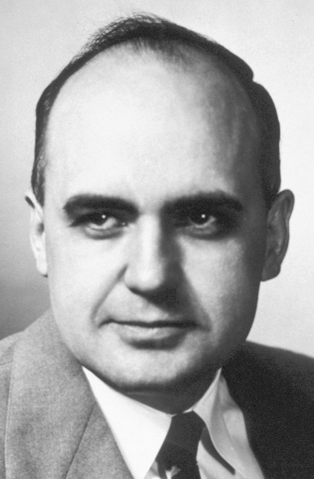

# Maurice Hilleman (1919–2005)

**Prerequisites:** none; see the linked lessons for context.

*Maurice Hilleman around 1958, as chief of the Department of Virus Diseases at the Walter Reed Army Institute of Research. Credit: Walter Reed Army Medical Center. License: Public domain. Source: [File:Hilleman-Walter-Reed.jpeg](https://commons.wikimedia.org/wiki/File:Hilleman-Walter-Reed.jpeg).*

## Who he was

Maurice Hilleman grew up on a farm in Montana and became perhaps the most productive vaccine scientist in history. After working at the Walter Reed Army Institute of Research, he led vaccine research at Merck from 1957 until his retirement. He is credited with developing more than 40 vaccines, including several still in routine use. He was little known to the public.

## Achievements

- **Pandemic warning.** In 1957 he recognised from reports in Hong Kong that a new influenza strain could cause a pandemic, and pushed for vaccine production before the Asian flu reached the US.
- **Mumps.** In 1963 his daughter Jeryl Lynn caught mumps; he cultured the virus from her throat and developed the Jeryl Lynn mumps vaccine strain, still used in MMR ([mumps](../03-diseases/mumps.md)).
- **MMR.** He combined measles, mumps and rubella vaccines into MMR, licensed in 1971 ([the MMR era](../04-history/10-the-mmr-era.md)).
- **Hepatitis B.** He developed the first hepatitis B vaccine, licensed in 1981, made from virus particles purified from the blood plasma of infected people and treated to inactivate any viruses, then helped develop the recombinant version that replaced it ([hepatitis B](../03-diseases/hepatitis-b.md)).
- **Others** included vaccines against hepatitis A, chickenpox, Hib and pneumococcus.

## SV40

In 1960 Hilleman and Ben Sweet identified a monkey virus, SV40, contaminating the rhesus monkey kidney cells used to make polio vaccines, which meant that millions of people had received live SV40 in polio vaccines given in the late 1950s and early 1960s. SV40 causes tumours in some animals. Merck changed its cell source, and later studies did not establish that SV40 in vaccines caused cancer in humans, though an Institute of Medicine review in 2002 found the evidence inadequate to accept or reject a link ([Institute of Medicine, *SV40 Contamination of Polio Vaccine and Cancer* (2002)](https://doi.org/10.17226/10534)). The episode is often cited by vaccine critics as an example of unforeseen contamination, and by vaccine scientists as an example of a problem found and fixed.

## Character and legacy

Hilleman was known for blunt language and fierce management. Paul Offit, who wrote a biography of him, credits his vaccines with saving millions of lives each year. Like other industrial scientists, he worked for a profit-making company, which critics of the vaccine industry emphasise; he received relatively few public honours for the scale of his work.

## Key ideas

- Hilleman developed more than 40 vaccines at Merck, including the mumps, MMR and first hepatitis B vaccines.
- His lab identified SV40 contamination of polio vaccines in 1960.
- He is an example of the central role of industry scientists in vaccine development.

## Where this leads

- [Stanley Plotkin](stanley-plotkin.md), who developed the rubella vaccine used in MMR.
