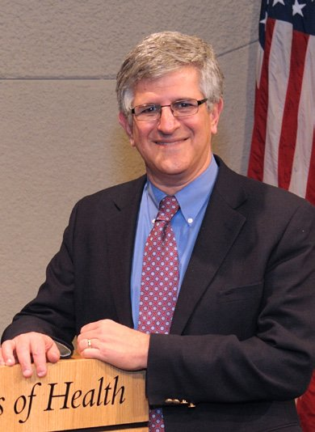

# Paul Offit (born 1951)

**Prerequisites:** none; see the linked lessons for context.

*Paul Offit, American paediatrician and vaccine scientist. Credit: Michael Spencer for the National Institutes of Health Record. License: Public domain. Source: [File:Paul Offit.jpg](https://commons.wikimedia.org/wiki/File:Paul_Offit.jpg).*

## Who he is

Paul Offit is an American paediatrician and infectious-disease specialist at the Children's Hospital of Philadelphia, where he directs the Vaccine Education Center, and a professor at the University of Pennsylvania. He is one of the best-known public defenders of vaccines.

## RotaTeq

With Stanley Plotkin and H. Fred Clark, Offit spent about 25 years developing a rotavirus vaccine, RotaTeq, licensed in 2006 and made by Merck. Rotavirus was then the leading cause of severe childhood diarrhoea, killing hundreds of thousands of children a year worldwide ([rotavirus](../03-diseases/rotavirus.md)). In 2008 the Children's Hospital of Philadelphia sold its royalty interest in RotaTeq for $182 million ([BioSpace, "Royalty Pharma AG acquires royalty interest in RotaTeq for $182 million" (2008)](https://www.biospace.com/royalty-pharma-ag-acquires-royalty-interest-in-rotateq-r-for-182-million)); Offit told a journalist his share was "several million dollars" ([Amy Wallace, *Wired*, "An epidemic of fear" (October 2009)](https://www.wired.com/2009/10/ff-waronscience/)).

## Public advocacy

Offit served on the CDC's Advisory Committee on Immunization Practices from 1998 to 2003. He has written books including *Autism's False Prophets* (2008), on the MMR and thimerosal controversies, *Deadly Choices* (2011), on the anti-vaccine movement, and *The Cutter Incident* (2005). He has debated vaccine critics in the media and testified in court and before Congress.

## Criticism

Vaccine critics have nicknamed him "Dr Proffit" and argue that his royalties and ties to Merck make him an unreliable advocate. Robert F. Kennedy Jr. and others have accused him of conflicts of interest during his time on ACIP, which overlapped with the development of his own rotavirus vaccine; he rejects the charge. Offit has said that his income is disclosed and that his arguments rest on studies by others. In 2019, defending openness about funding, he said what matters is "the strength and the internal consistency of the study, robustness and reproducibility of the data" ([*The Guardian*, "Professor who claims vaccines linked to autism funded through university portal" (1 June 2019)](https://www.theguardian.com/society/2019/jun/01/professor-who-links-vaccines-to-autism-funded-through-university-portal)). He has also criticised some public-health decisions, for example arguing that repeated COVID-19 boosters were not needed for healthy young people, which put him at odds with some colleagues and showed that defending vaccines in general does not mean endorsing every recommendation.

His case is a central example in [conflicts of interest and funding](../07-controversies/14-conflicts-of-interest-and-funding.md).

## Why he matters for this course

Offit illustrates several themes at once: the role of academic scientists in developing commercial vaccines, the way financial interests are used in public argument, and the difficulty of being both an inventor and an advocate. Readers can apply the questions in the reading-research course to his arguments as to anyone else's: whether the studies he cites are sound and replicated, regardless of who cites them ([weighing conflicts without ad hominem](../../../../science/research-methods/reading-research/08-funding-and-conflicts/05-weighing-conflicts-without-ad-hominem.md)).

## Key ideas

- Offit co-invented RotaTeq, and received several million dollars when royalty rights were sold.
- He is a prominent author and advocate for vaccines.
- Critics cite his financial interests; he argues evidence, not funding, should decide.

## Where this leads

- [Andrew Wakefield](andrew-wakefield.md), the central figure of the MMR controversy.
