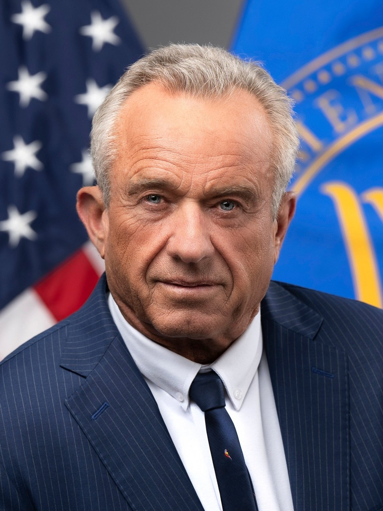

# Robert F. Kennedy Jr. (born 1954)

**Prerequisites:** none; see the linked lessons for context.

*Official portrait of Robert F. Kennedy Jr. as US Secretary of Health and Human Services, 2025. Credit: U.S. Department of Health and Human Services. License: Public domain. Source: [File:Robert F. Kennedy Jr., official portrait (2025) (cropped 3-4).jpg](https://commons.wikimedia.org/wiki/File:Robert_F._Kennedy_Jr.,_official_portrait_%282025%29_%28cropped_3-4%29.jpg).*

## Who he is

Robert F. Kennedy Jr. is an American lawyer and politician, son of Senator Robert F. Kennedy. He built a career as an environmental lawyer, with Riverkeeper and the Natural Resources Defense Council, before becoming the most prominent vaccine critic in the United States. In February 2025 the Senate confirmed him as Secretary of Health and Human Services by 52 votes to 48.

## Vaccine activism

Kennedy's 2005 article "Deadly Immunity", published by *Salon* and *Rolling Stone*, alleged a government cover-up of links between thimerosal and autism. *Salon* added corrections and in 2011 removed the article entirely, saying later evidence had undermined it ([Salon, "Correcting our record" (16 January 2011)](https://www.salon.com/2011/01/16/dangerous_immunity/); [thimerosal and autism](../07-controversies/02-thimerosal-and-autism.md)). He went on to lead the organisation that became Children's Health Defense, which campaigns against vaccine mandates and publicises claims of vaccine harm, and wrote books including *The Real Anthony Fauci* (2021). He had a financial interest in litigation against Merck over Gardasil, which he pledged to pass to his son on taking office ([New York Times, "RFK Jr. says he won't keep financial stake in HPV vaccine lawsuits" (30 January 2025)](https://www.nytimes.com/2025/01/30/health/rfk-jr-hpv-vaccine-lawsuits-fees.html)).

He has said he is not "anti-vaccine" but wants safer vaccines and better science. Critics point to his repeated statements linking vaccines to autism and other harms that large studies have not supported, and to his 2019 visit to Samoa months before a deadly measles epidemic ([outbreaks and coverage](../09-public-health-and-ethics/02-outbreaks-and-coverage.md)).

## As health secretary

As secretary, Kennedy:

- removed COVID-19 vaccines from routine recommendations for healthy children and pregnant women in 2025 ([COVID-19](../07-controversies/10-covid-19-vaccines-mandates-and-mortality.md));
- dismissed all 17 members of the CDC's vaccine advisory committee in June 2025 and appointed replacements, including vaccine critics ([FactCheck.org, "RFK Jr.'s flawed justifications for 'clean sweep' of CDC vaccine advisory panel" (June 2025)](https://www.factcheck.org/2025/06/rfk-jr-s-flawed-justifications-for-clean-sweep-of-cdc-vaccine-advisory-panel/));
- ended US funding for Gavi ([Reuters, "US to stop financial support of global vaccine alliance Gavi, health secretary says" (25 June 2025)](https://www.reuters.com/business/healthcare-pharmaceuticals/us-stop-financial-support-global-vaccine-alliance-gavi-says-health-secretary-2025-06-25/));
- announced claims about causes of autism, including acetaminophen in pregnancy, in September 2025 ([HHS autism claims](../07-controversies/05-hhs-autism-claims-2025.md));
- oversaw the January 2026 cut of the routine childhood schedule from 17 to 11 diseases, which a federal court preliminarily blocked in March 2026 pending appeal ([the US schedule](../05-schedules/02-the-us-schedule.md)).

Supporters see this as long-overdue scrutiny of a vaccine establishment captured by industry. Medical societies, many former CDC and FDA officials and most vaccine researchers argue that the changes ignore evidence and will cause outbreaks; some medical groups now issue their own schedules.

## Assessment

Kennedy is the clearest example of vaccine scepticism moving from the margins to government. Whatever one's view, his tenure has made the evidence on schedules, adjuvants, autism and conflicts of interest, covered throughout this course, newly politically consequential.

## Key ideas

- Kennedy was a leading vaccine critic for two decades before becoming health secretary in 2025.
- As secretary he replaced ACIP, changed COVID-19 recommendations, ended Gavi funding and reduced the childhood schedule.
- Supporters call this reform; most scientific bodies call it a departure from evidence.

## Where this leads

- [Katalin Karikó](katalin-kariko.md), whose work made mRNA vaccines possible.
