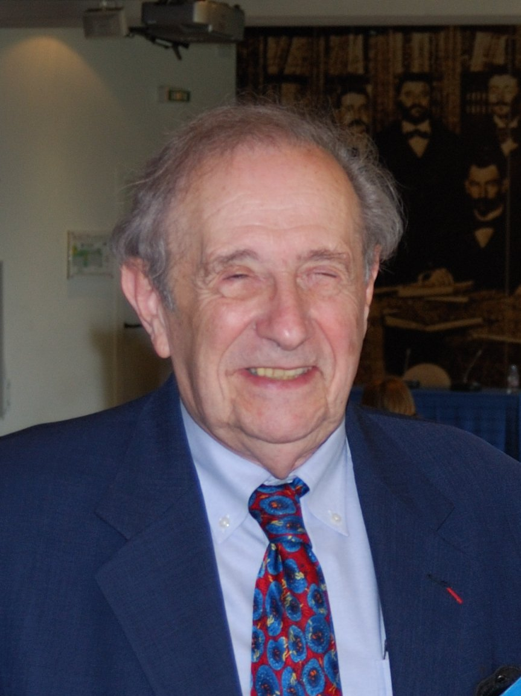

# Stanley Plotkin (born 1932)

**Prerequisites:** none; see the linked lessons for context.

*Stanley Plotkin at the ADVAC course in Annecy, France. Credit: Renat Latipov. License: Public domain. Source: [File:Stanley Plotkin.jpg](https://commons.wikimedia.org/wiki/File:Stanley_Plotkin.jpg).*

## Who he is

Stanley Plotkin is an American physician and vaccine scientist who worked at the Wistar Institute and the University of Pennsylvania, later at the vaccine maker Pasteur Mérieux Connaught (now Sanofi). He is the founding editor of *Plotkin's Vaccines*, the standard reference textbook.

## Rubella vaccine

During the rubella epidemic of 1964–65, which caused thousands of miscarriages and babies born with congenital rubella syndrome in the US, Plotkin developed a rubella vaccine strain, RA 27/3, grown in WI-38 cells, a human cell line derived from an aborted fetus in the 1960s. The vaccine was licensed in Europe and in the US in 1979, replacing earlier strains, and is the rubella component of MMR worldwide ([rubella](../03-diseases/rubella.md)). Its origin in fetal cell lines is the basis of religious objections discussed in [exemptions](../07-controversies/15-religious-and-philosophical-exemptions.md).

## Other work

Plotkin also worked on vaccines against rabies, cytomegalovirus and polio, and co-invented the rotavirus vaccine RotaTeq with Paul Offit and H. Fred Clark ([rotavirus](../03-diseases/rotavirus.md)). He developed the widely used concept of "correlates of protection", the immune measures that predict whether a vaccine protects.

## Controversies

Like many researchers of his era, Plotkin tested experimental vaccines on institutionalised children and orphans in the 1960s, practices now considered unethical. In a videotaped deposition given in a 2018 custody case, he discussed these studies, the use of fetal tissue, and vaccine ingredients. The video has been widely circulated by vaccine critics as evidence of unethical research; supporters say that it shows him answering frankly about practices that were accepted at the time. He has also received royalties and consulting fees from vaccine companies, which he discloses.

## Fetal cell lines in context

WI-38 and a similar cell line, MRC-5, were derived from two elective abortions in the 1960s and have been grown in laboratories ever since; no further abortions are needed to make vaccines. They are used for rubella, varicella, hepatitis A and some rabies vaccines because human cells grow these viruses well and are free of the animal viruses, such as SV40, that contaminated monkey kidney cells ([Hilleman](maurice-hilleman.md)). Religious authorities differ on whether using them is acceptable when alternatives are unavailable.

## Legacy

Rubella and congenital rubella syndrome have been eliminated from the Americas, largely through his vaccine. His textbook, now edited by others as well, is cited throughout this course.

## Key ideas

- Plotkin developed the RA 27/3 rubella vaccine, grown in a fetal cell line, still used worldwide.
- He co-invented RotaTeq and founded the main vaccine textbook.
- His 1960s research on institutionalised children and his 2018 deposition are cited by critics.

## Where this leads

- [Paul Offit](paul-offit.md), his co-inventor and a leading defender of vaccines.
