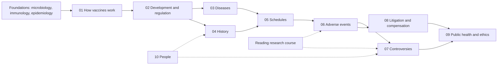

# Vaccines

A comprehensive course on vaccines: how they work, how they are made, tested and regulated, the diseases they prevent, their history, national schedules, adverse events, the major controversies, litigation and compensation, public-health ethics, and the people involved. It aims to be even-handed without being falsely balanced. Where the evidence is strong, as on MMR and autism or the existence of rare harms such as VITT, intussusception and narcolepsy after Pandemrix, the course says so plainly. Where questions are genuinely open or disputed, such as the best design for safety studies of the whole schedule, the adequacy of compensation schemes, the ethics of mandates or the 2025–26 changes to US policy, it sets out the strongest arguments on each side with sources.

Every section lists its key studies and sources with a one-line note on what each found and, where relevant, who funded it and what conflicts of interest the authors or critics had. Conflicts exist on all sides: manufacturer-funded trials, vaccine inventors who earn royalties, paid expert witnesses and lawyers in vaccine litigation, and advocacy organisations that sell products or raise funds from concern about vaccines. Conflicts do not make a finding wrong, but they tell you where to look harder. For the methods behind these judgements, from study designs and bias to statistics and funding, see the companion [reading research course](../../../science/research-methods/reading-research/README.md), which uses vaccine examples alongside others.

The course assumes the foundations in [microbiology](../../microbiology/README.md), [immunology](../README.md) and [epidemiology](../../epidemiology/README.md), and terms are defined in the [medicine glossary](../../glossary/README.md). It reflects the state of the evidence and of US, Canadian and UK policy as of late 2026; several matters, including the US schedule litigation, were still unresolved at the time of writing.

**Prerequisites:** [Immunology](../README.md) lessons 01–09 and [epidemiology](../../epidemiology/README.md) lessons 01–14; the [reading research course](../../../science/research-methods/reading-research/README.md) is strongly recommended before the adverse-events and controversies sections.

## Suggested reading order

1. **Foundations:** 01 How vaccines work, 02 Development and regulation.
2. **What is at stake:** 03 Diseases (dip in as needed) and 04 History.
3. **Practice:** 05 Schedules.
4. **Risks and disputes:** 06 Adverse events, then 07 Controversies, 08 Litigation and compensation.
5. **The bigger picture:** 09 Public health and ethics, and 10 People, which can be read at any point.

## Contents

- [How vaccines work](01-how-vaccines-work/README.md) (14 files)
  - [How vaccines work](01-how-vaccines-work/01-how-vaccines-work.md)
  - [Types of vaccines](01-how-vaccines-work/02-types-of-vaccines.md)
  - [Live attenuated vaccines](01-how-vaccines-work/03-live-attenuated-vaccines.md)
  - [Inactivated vaccines](01-how-vaccines-work/04-inactivated-vaccines.md)
  - [Toxoid vaccines](01-how-vaccines-work/05-toxoid-vaccines.md)
  - [Subunit and recombinant vaccines](01-how-vaccines-work/06-subunit-and-recombinant-vaccines.md)
  - [Conjugate vaccines](01-how-vaccines-work/07-conjugate-vaccines.md)
  - [Viral vector vaccines](01-how-vaccines-work/08-viral-vector-vaccines.md)
  - [mRNA vaccines](01-how-vaccines-work/09-mrna-vaccines.md)
  - [Adjuvants](01-how-vaccines-work/10-adjuvants.md)
  - [Excipients and ingredients](01-how-vaccines-work/11-excipients-and-ingredients.md)
  - [How vaccines are made](01-how-vaccines-work/12-how-vaccines-are-made.md)
  - [The cold chain](01-how-vaccines-work/13-the-cold-chain.md)
  - [Routes, doses and combination vaccines](01-how-vaccines-work/14-routes-doses-and-combination-vaccines.md)
- [Development, trials and regulation](02-development-and-regulation/README.md) (11 files)
  - [The development pipeline](02-development-and-regulation/01-development-pipeline.md)
  - [Clinical trial phases](02-development-and-regulation/02-clinical-trial-phases.md)
  - [The placebo controls debate](02-development-and-regulation/03-placebo-controls-debate.md)
  - [Trial ethics and human challenge studies](02-development-and-regulation/04-trial-ethics-and-human-challenge-studies.md)
  - [Licensing and regulators](02-development-and-regulation/05-licensing-and-regulators.md)
  - [Advisory committees: ACIP, NACI and JCVI](02-development-and-regulation/06-advisory-committees-acip-naci-and-jcvi.md)
  - [Post-market surveillance](02-development-and-regulation/07-post-market-surveillance.md)
  - [Reading VAERS correctly](02-development-and-regulation/08-reading-vaers-correctly.md)
  - [Active surveillance systems](02-development-and-regulation/09-active-surveillance-systems.md)
  - [Surveillance outside the US](02-development-and-regulation/10-surveillance-outside-the-us.md)
  - [Expert reviews: IOM, NASEM and Cochrane](02-development-and-regulation/11-expert-reviews-iom-nasem-cochrane.md)
- [The diseases](03-diseases/README.md) (29 files)
  - [Cholera](03-diseases/cholera.md)
  - [COVID-19](03-diseases/covid-19.md)
  - [Dengue](03-diseases/dengue.md)
  - [Diphtheria](03-diseases/diphtheria.md)
  - [Ebola](03-diseases/ebola.md)
  - [Haemophilus influenzae type b (Hib)](03-diseases/haemophilus-influenzae-type-b.md)
  - [Hepatitis A](03-diseases/hepatitis-a.md)
  - [Hepatitis B](03-diseases/hepatitis-b.md)
  - [Human papillomavirus (HPV)](03-diseases/hpv.md)
  - [Influenza](03-diseases/influenza.md)
  - [Japanese encephalitis](03-diseases/japanese-encephalitis.md)
  - [Malaria](03-diseases/malaria.md)
  - [Measles](03-diseases/measles.md)
  - [Meningococcal disease](03-diseases/meningococcal-disease.md)
  - [Mpox](03-diseases/mpox.md)
  - [Mumps](03-diseases/mumps.md)
  - [Pertussis (whooping cough)](03-diseases/pertussis.md)
  - [Pneumococcal disease](03-diseases/pneumococcal-disease.md)
  - [Polio](03-diseases/polio.md)
  - [Rabies](03-diseases/rabies.md)
  - [Rotavirus](03-diseases/rotavirus.md)
  - [Respiratory syncytial virus (RSV)](03-diseases/rsv.md)
  - [Rubella](03-diseases/rubella.md)
  - [Chickenpox and shingles](03-diseases/shingles-and-varicella.md)
  - [Smallpox](03-diseases/smallpox.md)
  - [Tetanus](03-diseases/tetanus.md)
  - [Tuberculosis and BCG](03-diseases/tuberculosis-and-bcg.md)
  - [Typhoid](03-diseases/typhoid.md)
  - [Yellow fever](03-diseases/yellow-fever.md)
- [History](04-history/README.md) (13 files)
  - [Variolation](04-history/01-variolation.md)
  - [Jenner and cowpox](04-history/02-jenner-and-cowpox.md)
  - [Compulsory vaccination and the anti-vaccination leagues](04-history/03-compulsory-vaccination-and-the-anti-vaccination-leagues.md)
  - [Pasteur and the germ theory vaccines](04-history/04-pasteur-and-the-germ-theory-vaccines.md)
  - [Early vaccines: toxoids and BCG](04-history/05-early-vaccines-toxoids-and-bcg.md)
  - [Salk, Sabin and the Cutter incident](04-history/06-salk-sabin-and-the-cutter-incident.md)
  - [Smallpox eradication](04-history/07-smallpox-eradication.md)
  - [The polio eradication campaign](04-history/08-polio-eradication.md)
  - [The 1976 swine flu affair](04-history/09-the-1976-swine-flu-affair.md)
  - [The MMR era](04-history/10-the-mmr-era.md)
  - [Hib and the conjugate revolution](04-history/11-hib-and-the-conjugate-revolution.md)
  - [HPV vaccine introduction](04-history/12-hpv-vaccine-introduction.md)
  - [COVID-19 vaccines and Operation Warp Speed](04-history/13-covid-19-vaccines-and-operation-warp-speed.md)
- [Schedules](05-schedules/README.md) (10 files)
  - [How schedules are built](05-schedules/01-how-schedules-are-built.md)
  - [The US schedule](05-schedules/02-the-us-schedule.md)
  - [Canada's schedule](05-schedules/03-canadas-schedule.md)
  - [The UK schedule](05-schedules/04-the-uk-schedule.md)
  - [The Danish and Nordic schedules](05-schedules/05-the-danish-and-nordic-schedules.md)
  - [Comparing schedules](05-schedules/06-comparing-schedules.md)
  - [Schedules over time](05-schedules/07-schedules-over-time.md)
  - [Pregnancy, adult and travel vaccination](05-schedules/08-pregnancy-adult-and-travel-vaccination.md)
  - [Contraindications and precautions](05-schedules/09-contraindications-and-precautions.md)
  - [Alternative and delayed schedules](05-schedules/10-alternative-and-delayed-schedules.md)
- [Adverse events](06-adverse-events/README.md) (14 files)
  - [Common reactions](06-adverse-events/01-common-reactions.md)
  - [Febrile seizures](06-adverse-events/02-febrile-seizures.md)
  - [Anaphylaxis](06-adverse-events/03-anaphylaxis.md)
  - [Syncope and shoulder injuries](06-adverse-events/04-syncope-and-shoulder-injuries.md)
  - [Intussusception and rotavirus vaccines](06-adverse-events/05-intussusception-and-rotavirus-vaccines.md)
  - [Guillain-Barré syndrome](06-adverse-events/06-guillain-barre-syndrome.md)
  - [Narcolepsy and Pandemrix](06-adverse-events/07-narcolepsy-and-pandemrix.md)
  - [Myocarditis and mRNA vaccines](06-adverse-events/08-myocarditis-and-mrna-vaccines.md)
  - [VITT and adenovirus vector vaccines](06-adverse-events/09-vitt-and-adenovirus-vector-vaccines.md)
  - [Vaccine-derived polio](06-adverse-events/10-vaccine-derived-polio.md)
  - [ITP and other blood disorders](06-adverse-events/11-itp-and-other-blood-disorders.md)
  - [Other rare serious reactions](06-adverse-events/12-other-rare-serious-reactions.md)
  - [Causality assessment](06-adverse-events/13-causality-assessment.md)
  - [Weighing risks against benefits](06-adverse-events/14-weighing-risks-against-benefits.md)
- [Controversies](07-controversies/README.md) (19 files)
  - [MMR and autism](07-controversies/01-mmr-and-autism.md)
  - [Thimerosal and autism](07-controversies/02-thimerosal-and-autism.md)
  - [Autism: the epidemiology of diagnosis](07-controversies/03-autism-the-epidemiology-of-diagnosis.md)
  - [CDC whistleblower claims](07-controversies/04-cdc-whistleblower-claims.md)
  - [The 2025 HHS autism claims](07-controversies/05-hhs-autism-claims-2025.md)
  - [Aluminium adjuvants](07-controversies/06-aluminium-adjuvants.md)
  - [Too many, too soon](07-controversies/07-too-many-too-soon.md)
  - [DTP and whole-cell pertussis](07-controversies/08-dtp-and-whole-cell-pertussis.md)
  - [HPV vaccine safety claims](07-controversies/09-hpv-vaccine-safety-claims.md)
  - [COVID-19 vaccines, mandates and mortality](07-controversies/10-covid-19-vaccines-mandates-and-mortality.md)
  - [Natural versus vaccine immunity](07-controversies/11-natural-versus-vaccine-immunity.md)
  - [The historical mortality decline argument](07-controversies/12-historical-mortality-decline-argument.md)
  - [SIDS and vaccines](07-controversies/13-sids-and-vaccines.md)
  - [Conflicts of interest and funding](07-controversies/14-conflicts-of-interest-and-funding.md)
  - [Religious and philosophical exemptions](07-controversies/15-religious-and-philosophical-exemptions.md)
  - [Dengvaxia in the Philippines](07-controversies/16-dengvaxia-in-the-philippines.md)
  - [Trovan, Kano and the polio boycott](07-controversies/17-trovan-kano-and-the-polio-boycott.md)
  - [The CIA's fake vaccination campaign in Pakistan](07-controversies/18-cia-fake-vaccination-in-pakistan.md)
  - [Trust and misinformation](07-controversies/19-trust-and-misinformation.md)
- [Litigation and compensation](08-litigation-and-compensation/README.md) (10 files)
  - [The 1980s DTP lawsuits](08-litigation-and-compensation/01-the-1980s-dtp-lawsuits.md)
  - [The National Childhood Vaccine Injury Act of 1986](08-litigation-and-compensation/02-the-national-childhood-vaccine-injury-act-1986.md)
  - [The Vaccine Injury Compensation Program](08-litigation-and-compensation/03-vaccine-injury-compensation-program.md)
  - [The Vaccine Injury Table](08-litigation-and-compensation/04-the-vaccine-injury-table.md)
  - [The omnibus autism proceeding](08-litigation-and-compensation/05-the-omnibus-autism-proceeding.md)
  - [The PREP Act and the CICP](08-litigation-and-compensation/06-prep-act-and-cicp.md)
  - [Canada's compensation programs](08-litigation-and-compensation/07-canadas-compensation-programs.md)
  - [Litigation outside the VICP](08-litigation-and-compensation/08-litigation-outside-the-vicp.md)
  - [Mandate cases from Jacobson to COVID](08-litigation-and-compensation/09-mandate-cases-jacobson-to-covid.md)
  - [COVID-19 litigation](08-litigation-and-compensation/10-covid-19-litigation.md)
- [Public health and ethics](09-public-health-and-ethics/README.md) (4 files)
  - [Eradication and elimination](09-public-health-and-ethics/01-eradication-and-elimination.md)
  - [Outbreaks and coverage](09-public-health-and-ethics/02-outbreaks-and-coverage.md)
  - [Global immunisation programmes](09-public-health-and-ethics/03-global-immunisation-programmes.md)
  - [Mandates and ethics](09-public-health-and-ethics/04-mandates-and-ethics.md)
- [People in vaccine history](10-people/README.md) (12 files)
  - [Albert Sabin (1906–1993)](10-people/albert-sabin.md)
  - [Andrew Wakefield (born 1956)](10-people/andrew-wakefield.md)
  - [Barbara Loe Fisher](10-people/barbara-loe-fisher.md)
  - [D. A. Henderson (1928–2016)](10-people/d-a-henderson.md)
  - [Edward Jenner (1749–1823)](10-people/edward-jenner.md)
  - [Jonas Salk (1914–1995)](10-people/jonas-salk.md)
  - [Katalin Karikó (born 1955)](10-people/katalin-kariko.md)
  - [Louis Pasteur (1822–1895)](10-people/louis-pasteur.md)
  - [Maurice Hilleman (1919–2005)](10-people/maurice-hilleman.md)
  - [Paul Offit (born 1951)](10-people/paul-offit.md)
  - [Robert F. Kennedy Jr. (born 1954)](10-people/robert-f-kennedy-jr.md)
  - [Stanley Plotkin (born 1932)](10-people/stanley-plotkin.md)

## Key studies & sources

Every source below was checked to exist (DOI, court record or official page). Notes summarise what each found and its main strengths or limitations.

### Landmark trials and efficacy studies

- [Francis et al., *JAMA* 1955 (1954 polio field trial)](https://doi.org/10.1001/jama.1955.02960140028004): Evaluation of the 1954 Salk field trial: 80–90% efficacy against paralytic polio. Funded by the National Foundation for Infantile Paralysis; independent evaluation centre.
- [Polack et al., *NEJM* 2020 (BNT162b2 trial)](https://doi.org/10.1056/NEJMoa2034577): Phase 3 Pfizer–BioNTech trial; about 95% efficacy against symptomatic COVID-19. Manufacturer funded; short follow-up.
- [Baden et al., *NEJM* 2021 (mRNA-1273 trial)](https://doi.org/10.1056/NEJMoa2035389): Phase 3 Moderna trial; 94.1% efficacy. Co-funded by the US government and Moderna.
- [Shattock et al., *Lancet* 2024](https://doi.org/10.1016/S0140-6736(24)00850-X): Modelling estimate that immunisation saved about 154 million lives over 50 years of EPI. WHO-led; relies on model assumptions.

### Confirmed harms

- [Kim et al., *American Journal of Epidemiology* 1969](https://doi.org/10.1093/oxfordjournals.aje.a120955): 1960s formalin-inactivated RSV vaccine worsened disease in infants. A documented vaccine harm.
- [Murphy et al., *NEJM* 2001](https://doi.org/10.1056/NEJM200102223440804): RotaShield and intussusception, about 1 per 10,000; led to withdrawal. CDC study.
- [Nohynek et al., *PLoS One* 2012](https://doi.org/10.1371/journal.pone.0033536): Pandemrix and narcolepsy in Finnish children. Some authors had GSK funding, yet reported the harm.
- [Greinacher et al., *NEJM* 2021](https://doi.org/10.1056/NEJMoa2104840): First description of VITT after the AstraZeneca vaccine.
- [Mevorach et al., *NEJM* 2021](https://doi.org/10.1056/NEJMoa2109730): Israeli national data on myocarditis after mRNA vaccines, highest in young males.
- [Klein et al., *Pediatrics* 2010](https://doi.org/10.1542/peds.2010-0665): MMRV doubled febrile-seizure risk versus separate MMR plus varicella. Some authors had manufacturer research funding.

### Safety studies on contested claims

- [Hviid et al., *Annals of Internal Medicine* 2019](https://doi.org/10.7326/M18-2101): Danish cohort of 657,461 children; no increased autism risk after MMR. Funded by the Novo Nordisk Foundation and Danish Ministry of Health.
- [Taylor, Swerdfeger & Eslick, *Vaccine* 2014 (meta-analysis)](https://doi.org/10.1016/j.vaccine.2014.04.085): Meta-analysis of 1.2 million children: no link between vaccines, thimerosal or mercury and autism.
- [Andersson & Hviid, *Annals of Internal Medicine* 2025 (aluminium adjuvants, Denmark)](https://doi.org/10.7326/ANNALS-25-00997): Danish cohort of 1.2 million: aluminium not associated with 50 chronic disorders. The HHS secretary sought retraction; the journal declined.
- [Wakefield et al., *Lancet* 1998 (retracted)](https://doi.org/10.1016/S0140-6736(97)11096-0): The retracted MMR case series; undisclosed legal-aid funding and patent interests.

### Expert reviews

- [Institute of Medicine, *Adverse Effects of Vaccines: Evidence and Causality* (2011)](https://doi.org/10.17226/13164): IOM review of 158 vaccine–event pairs: 14 convincingly causal, 5 favouring rejection, most inadequate evidence. Commissioned by HRSA, which runs the VICP.
- [Institute of Medicine, *The Childhood Immunization Schedule and Safety* (2013)](https://doi.org/10.17226/13563): IOM review of the whole childhood schedule: no evidence of harm, but few studies of the schedule as a whole.
- [NASEM, *Evidence Review of the Adverse Effects of COVID-19 Vaccination* (2024)](https://doi.org/10.17226/27746): NASEM review of COVID-19 vaccine adverse effects: myocarditis with mRNA vaccines established; many outcomes inadequately studied.

### Funding and bias

- [Lundh et al., Cochrane methodology review, 2017](https://doi.org/10.1002/14651858.MR000033.pub3): Cochrane review: industry-sponsored studies report more favourable results.
- [Jefferson et al., *BMJ* 2009](https://doi.org/10.1136/bmj.b354): Industry-funded influenza vaccine studies were published in more prestigious journals regardless of quality. Lead author disclosed past GSK shares.

## References & further reading

- **Beginner.** Paul A. Offit, *Deadly Choices: How the Anti-Vaccine Movement Threatens Us All* (2011). A forceful case for vaccines by a vaccine co-inventor; read with his conflicts in mind.
- **Beginner.** Eula Biss, *On Immunity: An Inoculation* (2014). A reflective essay on fear, trust and vaccination.
- **Beginner.** Heidi J. Larson, *Stuck: How Vaccine Rumors Start and Why They Don't Go Away* (2020). Vaccine confidence from a researcher who studies it.
- **Intermediate.** Seth Mnookin, *The Panic Virus* (2011). History of the vaccine-autism controversy.
- **Intermediate.** Elena Conis, *Vaccine Nation: America's Changing Relationship with Immunization* (2015). A historian's account of US vaccine politics.
- **Intermediate.** Louise Kuo Habakus and Mary Holland (eds), *Vaccine Epidemic* (2011). The case of vaccine-choice advocates; read critically.
- **Intermediate.** Anna Kirkland, *Vaccine Court: The Law and Politics of Injury* (2016). The VICP, fairly assessed.
- **Advanced.** Stanley A. Plotkin, Walter A. Orenstein, Paul A. Offit and Kathryn M. Edwards (eds), *Plotkin's Vaccines* (8th ed., 2023). The standard reference; several editors developed vaccines.
- **Advanced.** Institute of Medicine, *Adverse Effects of Vaccines: Evidence and Causality* (2012). The most thorough causality review; free online.
