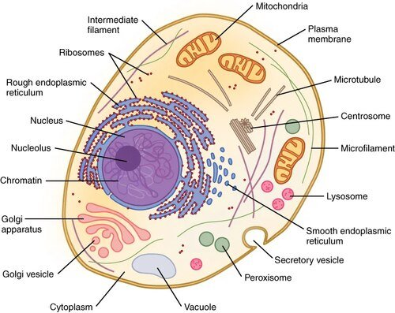
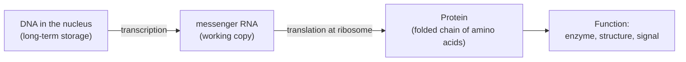

# Cells and the chemistry of life

**Prerequisites:** none. This is the starting point of the medicine branch.

*Diagram of a typical animal cell, showing the nucleus, mitochondria and other organelles. Credit: Unknown authorUnknown author. License: [CC BY 4.0](https://creativecommons.org/licenses/by/4.0). Source: [File:Typical_human_cell.tif](https://commons.wikimedia.org/wiki/File:Typical_human_cell.tif).*

## Why start with cells

Every vaccine works by teaching one set of living cells (your immune cells) to recognise molecules made by another living thing (a virus, a bacterium) or by its products (a toxin). You cannot follow that story without a few basic facts about what cells are, what they are made of, and how they read genetic instructions. This lesson gives just enough of that.

## The cell as the unit of life

A **cell** is a tiny bag of water and chemicals wrapped in a fatty membrane. Inside, thousands of chemical reactions run at once: breaking down food for energy, building new parts, copying genetic material, and responding to signals from outside. Every known living organism is either one cell (a bacterium, an amoeba) or many cells cooperating (a mushroom, a tree, a human). An adult human is made of roughly 30 trillion of them, of hundreds of specialised types: nerve cells, muscle cells, red blood cells, and the many types of white blood cell that make up the [immune system](../immunology/01-the-immune-system-at-a-glance.md).

Cells come in two broad designs:

- **Prokaryotes** (bacteria and archaea) have no nucleus. Their DNA floats in the cell's interior, usually as one circular chromosome, often with small extra rings called plasmids. They are typically 1 to 5 micrometres long.
- **Eukaryotes** (animals, plants, fungi, and single-celled organisms like the malaria parasite) keep their DNA inside a membrane-bound **nucleus** and have other internal compartments called organelles, such as mitochondria. They are usually ten or more times larger.

This difference matters medically. Antibiotics work because bacterial machinery differs from ours: they can block a bacterial ribosome or cell wall without harming human cells. Viruses, which are not cells at all, are covered in [their own lesson](03-viruses.md).

## The four big families of molecules

Living things are built mainly from four kinds of large molecule:

1. **Proteins**: chains of amino acids folded into precise shapes. They do most of the work in a cell: enzymes speed up reactions, structural proteins hold things together, receptors sense the outside world. Antibodies are proteins, and so are most of the things antibodies recognise.
2. **Nucleic acids**: DNA and RNA, long chains of four chemical "letters" that store and transmit genetic information.
3. **Carbohydrates**: sugars and their chains (polysaccharides). Many bacteria wrap themselves in a slippery **polysaccharide capsule**, which becomes important when we reach [[conjugate-vaccines|conjugate vaccines]].
4. **Lipids**: fats and oils, which form the membranes around every cell and around some viruses. The lipid nanoparticles in mRNA vaccines borrow this chemistry.

## From gene to protein

The core flow of information in biology is often summarised as **DNA → RNA → protein**:

A **gene** is a stretch of DNA that carries the recipe for a protein. When the cell needs that protein, it copies the gene into **messenger RNA (mRNA)**. The mRNA travels to a **ribosome**, a molecular machine that reads it three letters at a time and strings together the matching amino acids. The finished chain folds into a shape determined by its sequence. mRNA is deliberately short-lived; cells break it down within hours to days so that protein production can be switched off.

Two points from this will matter later:

- **Viruses hijack exactly this machinery.** A virus brings its own genetic instructions and uses the host cell's ribosomes to make viral proteins.
- **mRNA vaccines use it too.** They deliver an mRNA recipe for one viral protein; the person's own cells read it and make that protein for a short time, which the immune system then learns to recognise. The mRNA does not enter the nucleus and is not built into DNA. The details are in [[mrna-vaccines|the mRNA lesson]].

## Shape is everything

The immune system does not read genetic sequences directly. It recognises **shapes**: small patches on the surface of proteins and sugars, called [[g:epitope|epitopes]]. Change a protein's sequence and you may change its shape, which is why some viruses (influenza is the classic example) can slip past existing immunity by mutating the proteins on their surface. It is also why a vaccine protein must be held in the right shape to train useful antibodies, a lesson learned the hard way with the RSV vaccine failure of the 1960s, described in [[rsv|the RSV overview]].

## Key ideas

- The cell is the basic unit of life; bacteria are prokaryotic cells, humans are made of eukaryotic cells, and viruses are not cells.
- Proteins, nucleic acids, carbohydrates and lipids are the main building blocks; vaccines target proteins and sometimes sugar capsules.
- Genetic information flows from DNA to messenger RNA to protein; viruses and mRNA vaccines both use the cell's protein-making machinery.
- The immune system recognises molecular shapes (epitopes), so changes in shape can let a pathogen escape immunity.

## Where this leads

- Next: [Bacteria](02-bacteria.md), then [viruses](03-viruses.md).
- Later: [the immune system at a glance](../immunology/01-the-immune-system-at-a-glance.md) and [[mrna-vaccines|mRNA vaccines]].
