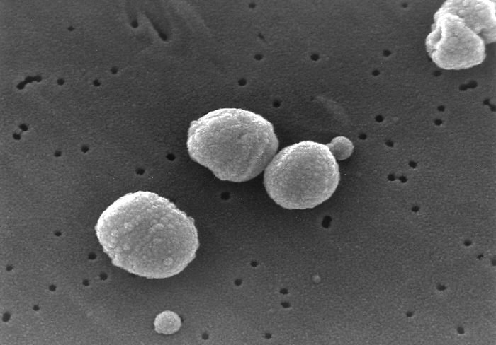
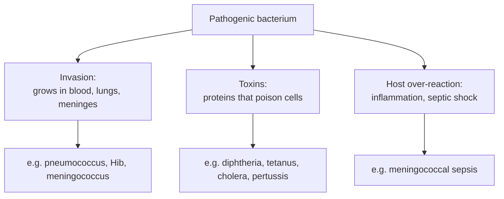

# Bacteria

**Prerequisites:** [Cells and the chemistry of life](01-cells-and-the-chemistry-of-life.md)

*Streptococcus pneumoniae seen under the microscope; this bacterium causes pneumonia, meningitis and ear infections, and is the target of pneumococcal vaccines. Credit: Photo Credit: CDC/Janice Carr Content Providers(s): CDC/Dr. Richard Facklam. License: Public domain. Source: [File:Streptococcus pneumoniae.jpg](https://commons.wikimedia.org/wiki/File:Streptococcus_pneumoniae.jpg).*

## Small, old and mostly harmless

Bacteria are single prokaryotic cells. They were on Earth for billions of years before animals appeared, and they live almost everywhere: in soil, oceans, hot springs, and on and inside every person. The human gut alone carries trillions of bacterial cells, most of them harmless or helpful (they digest fibre, make vitamins, and crowd out dangerous species). Only a small fraction of bacterial species cause disease; these are called **pathogens**.

## Anatomy of a bacterium

A typical bacterium has:

- a **cell membrane** and, outside it, a rigid **cell wall** made of peptidoglycan. The thickness of this wall is what the **Gram stain** detects: Gram-positive bacteria (such as *Streptococcus*, *Staphylococcus*, *Clostridium*) hold the purple dye; Gram-negative bacteria (such as *Neisseria*, *Haemophilus*, *Salmonella*, *Vibrio*) have a thinner wall plus an outer membrane and stain pink.
- often a **polysaccharide capsule**, a sugary coat that helps the bacterium resist being swallowed by immune cells. The capsule is the key target in pneumococcal, Hib, meningococcal and typhoid Vi vaccines.
- sometimes **flagella** (whip-like tails for swimming) and **pili** (hair-like hooks for sticking to tissues). Pertussis bacteria use adhesins like filamentous haemagglutinin and pertactin, which are components of acellular pertussis vaccines.
- a chromosome and sometimes **plasmids**, small DNA rings that can carry genes for antibiotic resistance or toxins and can be passed between bacteria.

Bacteria reproduce by splitting in two (binary fission). Under good conditions some species can double every 20 minutes, which is why an infection can escalate in hours.

## How bacteria cause disease

Pathogenic bacteria harm us in a few main ways:

1. **Invasion.** Some bacteria get into normally sterile places such as the blood (bacteraemia, sepsis), the lining of the brain (meningitis) or the lungs (pneumonia). The capsule helps them survive there. These "invasive" diseases are what Hib, pneumococcal and meningococcal vaccines prevent.
2. **Toxins.** Some bacteria do most of their damage by releasing protein toxins. Tetanus bacteria can sit in a small wound while their toxin travels along nerves and causes spasms. Diphtheria toxin kills cells in the throat and can damage the heart. Cholera toxin makes the gut pour out water. These diseases are covered in [toxins and toxin-mediated disease](04-toxins-and-toxin-mediated-disease.md).
3. **Provoking the host.** Components of the bacterial surface, such as the lipopolysaccharide (endotoxin) of Gram-negative bacteria, can trigger a massive inflammatory reaction. In meningococcal sepsis, it is partly the body's own response that causes shock.

## Carriers and colonisation

Many dangerous bacteria live harmlessly in some people for weeks or months. This is **colonisation** or **carriage**. *Streptococcus pneumoniae*, *Haemophilus influenzae* type b and *Neisseria meningitidis* commonly live in the nose and throat of healthy children and teenagers, and occasionally invade. Carriers spread the bacteria to others. A vaccine that reduces carriage (as conjugate vaccines do) protects not only the vaccinated child but also the unvaccinated people around them, an example of [herd protection](../epidemiology/04-herd-immunity.md).

## Antibiotics and their limits

Antibiotics transformed the treatment of bacterial disease from the 1940s onward, but they do not make vaccines unnecessary:

- Some diseases kill or disable faster than antibiotics can act. Meningococcal disease can kill within 24 hours of the first symptoms, and survivors may lose limbs or hearing.
- Toxin-mediated diseases (tetanus, diphtheria) need antitoxin, because killing the bacteria does not undo toxin already bound to tissues.
- **Antibiotic resistance** is rising. Vaccines reduce the number of infections that need antibiotics; the WHO counts vaccination among its tools against resistance.

## Key ideas

- Most bacteria are harmless; a minority are pathogens.
- The capsule, cell wall and surface proteins are what the immune system (and many vaccines) target.
- Bacteria cause disease by invading tissues, by releasing toxins, or by provoking a damaging host response.
- Healthy carriers spread pathogens; vaccines that reduce carriage protect the community as well as the individual.

## Where this leads

- Next: [Viruses](03-viruses.md), then [toxins](04-toxins-and-toxin-mediated-disease.md).
- Related: [conjugate vaccines](../immunology/vaccines/01-how-vaccines-work/07-conjugate-vaccines.md), [[pneumococcal-disease|pneumococcal disease]], [[haemophilus-influenzae-type-b|Hib]].
