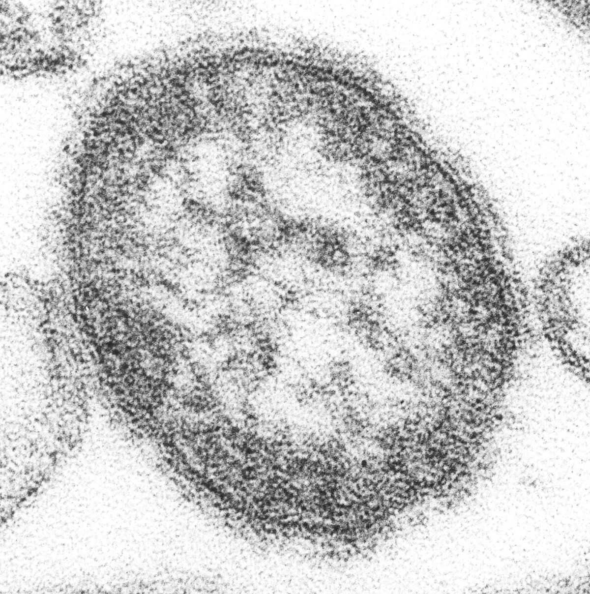
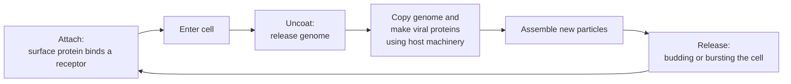

# Viruses

**Prerequisites:** [Cells and the chemistry of life](01-cells-and-the-chemistry-of-life.md)

*Transmission electron micrograph of measles virus particles. Credit: Photo Credit: Cynthia S. Goldsmith Content Providers(s): CDC/ Courtesy of Cynthia S. Goldsmith; William Bellini, Ph.D. License: Public domain. Source: [File:Measles virus.JPG](https://commons.wikimedia.org/wiki/File:Measles_virus.JPG).*

## Not quite alive

A **virus** is a package of genetic material (DNA or RNA) wrapped in a protein shell called a **capsid**, and sometimes also in a fatty outer **envelope** taken from the cell it last left. Viruses are much smaller than bacteria: most are 20 to 300 nanometres across, so they are visible only with an electron microscope. They have no metabolism of their own and cannot reproduce on their own. Outside a cell, a virus is an inert particle. Inside one, it takes over.

## The viral life cycle

1. **Attachment.** A protein on the virus surface fits a receptor on a particular kind of host cell. SARS-CoV-2's spike protein binds the ACE2 receptor; influenza's haemagglutinin binds sialic acid; measles virus binds receptors on immune cells and airway cells. This fit decides which species and tissues a virus can infect.
2. **Entry and uncoating.** The virus or its genome gets inside.
3. **Replication.** The viral genome is copied and its genes are translated by the host's ribosomes.
4. **Assembly and release.** New particles assemble and leave, either by bursting the cell or by budding from its membrane.

Because attachment depends on surface proteins, antibodies that coat those proteins can block infection. These are called **neutralising antibodies**, and producing them is the goal of most antiviral vaccines.

## Kinds of virus that matter for vaccines

Viruses are classified by their genome (DNA or RNA, single- or double-stranded) and structure. A few distinctions matter for this course:

- **RNA viruses** (measles, mumps, rubella, polio, influenza, rotavirus, SARS-CoV-2, RSV, dengue, yellow fever, rabies, Ebola) generally copy themselves with error-prone enzymes, so they mutate quickly. Some, like influenza, change their surface enough to need updated vaccines; others, like measles, are remarkably stable, so a vaccine from the 1960s still works.
- **DNA viruses** (smallpox and mpox, hepatitis B, HPV, varicella-zoster) mutate more slowly. Herpesviruses such as varicella-zoster can hide in nerve cells for life and reactivate decades later as shingles.
- **Enveloped vs non-enveloped.** Enveloped viruses (measles, influenza, SARS-CoV-2) are destroyed by soap and drying; non-enveloped ones (polio, rotavirus, norovirus, hepatitis A) are hardier and spread well through contaminated water and surfaces.
- **Integration and cancer.** A few viruses can drive cancer: high-risk HPV types cause almost all cervical cancers, and chronic hepatitis B infection is a major cause of liver cancer. Vaccines against these two are, in effect, cancer-prevention vaccines.

## Acute, chronic and latent infection

- **Acute**: the virus replicates, the immune system clears it within days or weeks (measles, influenza).
- **Chronic**: the virus persists and keeps replicating for years (hepatitis B in many infants infected at birth; around 90% of infants infected perinatally become chronic carriers, according to the WHO).
- **Latent**: the virus goes dormant inside cells and can reactivate (varicella-zoster, herpes simplex).

## Why antivirals are limited

There are far fewer antiviral drugs than antibiotics, because viruses use the host's own machinery and there are fewer unique targets to hit without harming human cells. For many viral diseases (measles, polio, rabies once symptoms appear) there is no effective cure, only supportive care. This is one reason prevention by vaccination has been so central for viral disease.

## Zoonoses

Many viruses jump from animals to humans (**zoonoses**). Rabies comes from mammal bites; yellow fever and dengue are carried by mosquitoes; Ebola and mpox have animal reservoirs. A disease with an animal reservoir cannot be eradicated by vaccinating humans alone; smallpox could be eradicated partly because it infected only humans. See [[eradication-and-elimination|eradication and elimination]].

## Key ideas

- Viruses are genetic material in a protein shell, sometimes with an envelope; they reproduce only inside host cells.
- Surface proteins decide which cells a virus infects; neutralising antibodies work by blocking them.
- RNA viruses tend to mutate faster; some need updated vaccines, others are stable.
- Some viruses cause chronic infection or cancer (hepatitis B, HPV); some have animal reservoirs, which affects whether they can be eradicated.

## Where this leads

- Next: [Toxins and toxin-mediated disease](04-toxins-and-toxin-mediated-disease.md).
- Later: [live attenuated vaccines](../immunology/vaccines/01-how-vaccines-work/03-live-attenuated-vaccines.md), [[measles|measles]], [[influenza|influenza]].
