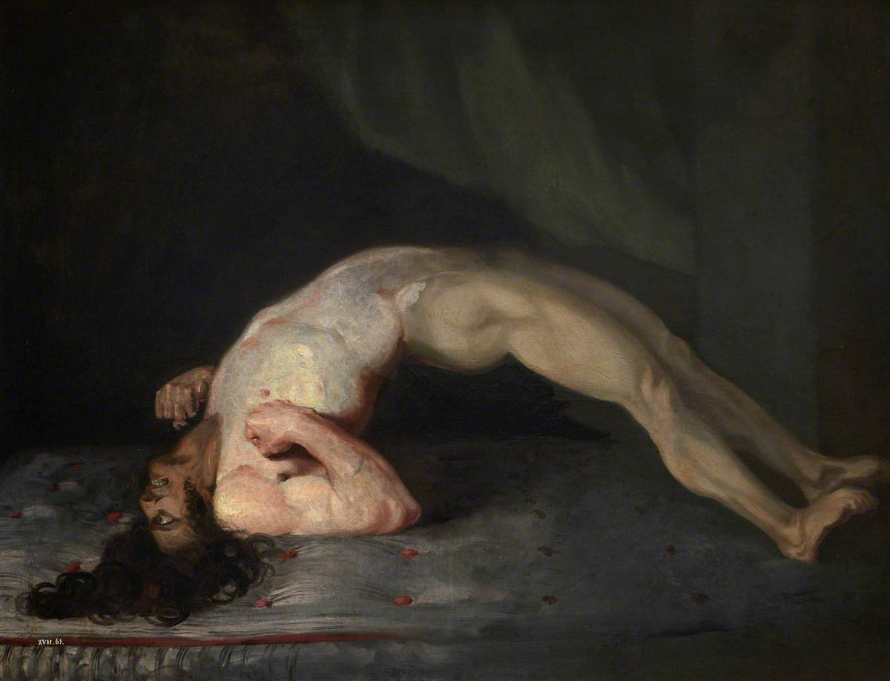
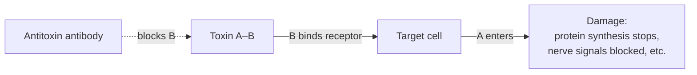

# Toxins and toxin-mediated disease

**Prerequisites:** [Bacteria](02-bacteria.md)

*Charles Bell's 1809 painting of a soldier with tetanus, showing opisthotonus, the arched spasm caused by tetanus toxin. Credit: Sir Charles Bell. License: Public domain. Source: [File:Opisthotonus_in_a_patient_suffering_from_tetanus_-_Painting_by_Sir_Charles_Bell_-_1809.jpg](https://commons.wikimedia.org/wiki/File:Opisthotonus_in_a_patient_suffering_from_tetanus_-_Painting_by_Sir_Charles_Bell_-_1809.jpg).*

## When the poison is the problem

For some bacterial diseases, the bacteria themselves do relatively little damage. The harm comes from a protein **toxin** they release. The toxin may act far from where the bacteria are growing. This is why these diseases need a special kind of vaccine, the [toxoid](../immunology/vaccines/01-how-vaccines-work/05-toxoid-vaccines.md), which trains the immune system to neutralise the toxin rather than (or as well as) the bacterium.

## Exotoxins and endotoxins

- **Exotoxins** are proteins secreted by bacteria. They are among the most potent poisons known. They are usually specific: each binds a particular receptor and disrupts a particular process.
- **Endotoxin** is the lipopolysaccharide in the outer membrane of Gram-negative bacteria. It is released when bacteria die and triggers fever and inflammation. It is not neutralised by toxoid vaccines.

Many exotoxins share an **A–B structure**: the B ("binding") part docks on to a cell receptor, and the A ("active") part gets inside and does the damage. Antibodies against the B part can stop the toxin from binding at all. That is how antitoxin and toxoid-induced immunity work.

## Four toxin diseases in the vaccine story

**Tetanus.** *Clostridium tetani* spores live in soil and enter through wounds. In the low-oxygen environment of a deep wound, they germinate and make **tetanospasmin**, which travels up nerves to the spinal cord and blocks the signals that tell muscles to relax. The result is painful, sustained spasm: lockjaw, the arched back seen in Bell's painting above, and in severe cases inability to breathe. Tetanus is not contagious from person to person, so there is no herd immunity; every person is protected only by their own immunity. Recovering from tetanus does not reliably give immunity, because the amount of toxin that causes disease is too small to provoke a strong immune response. See [tetanus](../immunology/vaccines/03-diseases/tetanus.md).

**Diphtheria.** *Corynebacterium diphtheriae* infects the throat. Its toxin (made only by strains carrying a particular bacteriophage gene) stops protein synthesis in cells, causing a thick grey "pseudomembrane" that can block the airway, and it can travel through the blood to damage the heart and nerves. Before vaccination it was a leading killer of children; the 19th-century name "strangling angel of children" describes it. See [diphtheria](../immunology/vaccines/03-diseases/diphtheria.md).

**Pertussis (whooping cough).** *Bordetella pertussis* makes several toxins, including **pertussis toxin**, which contributes to the high white-cell counts and severe disease in infants. The disease is also driven by the bacteria sticking to and damaging the airway lining, so pertussis vaccines target several antigens, not just the toxin. See [pertussis](../immunology/vaccines/03-diseases/pertussis.md).

**Cholera.** *Vibrio cholerae* produces cholera toxin in the gut, which forces intestinal cells to pump out salt and water. Untreated, severe cholera can kill by dehydration within hours. Oral rehydration saves most patients. Some oral cholera vaccines include the toxin's B subunit. See [cholera](../immunology/vaccines/03-diseases/cholera.md).

## Antitoxin: the first immune therapy

In 1890 Emil von Behring and Kitasato Shibasaburō showed that serum from animals immunised against tetanus or diphtheria toxin could protect other animals. **Antitoxin** made in horses became the first effective treatment for diphtheria, and von Behring received the first Nobel Prize in Physiology or Medicine (1901). This was **passive immunity**: borrowed antibodies, effective at once but lasting only weeks. It is still used (tetanus immune globulin, diphtheria antitoxin). The step to lasting **active** immunity came with **toxoids**: in the 1920s Gaston Ramon found that treating toxin with formaldehyde and heat destroyed its poison while keeping its shape, so it could be injected safely to teach the body to make its own antitoxin. The history is told in [early vaccines, toxoids and BCG](../immunology/vaccines/04-history/05-early-vaccines-toxoids-and-bcg.md).

## Botulinum and others

Botulinum toxin (from *Clostridium botulinum*) is even more potent than tetanus toxin and paralyses muscles instead of locking them. A botulism toxoid existed for laboratory workers in the US but was discontinued; it is mentioned here only because it illustrates that toxoids are a general approach.

## Key ideas

- Some bacteria harm mainly through protein exotoxins, which can act far from the infection.
- Many exotoxins have a binding part and an active part; antibodies that block binding neutralise them.
- Tetanus, diphtheria, pertussis and cholera are toxin-driven diseases central to vaccine history.
- Antitoxin (passive, short-lived) came first; toxoids (inactivated toxins, active and lasting) followed.

## Where this leads

- Next: [Parasites and fungi](05-parasites-and-fungi.md), then [infection and transmission](06-infection-and-transmission.md).
- Later: [toxoid vaccines](../immunology/vaccines/01-how-vaccines-work/05-toxoid-vaccines.md), [passive and active immunity](../immunology/08-passive-and-active-immunity.md).
