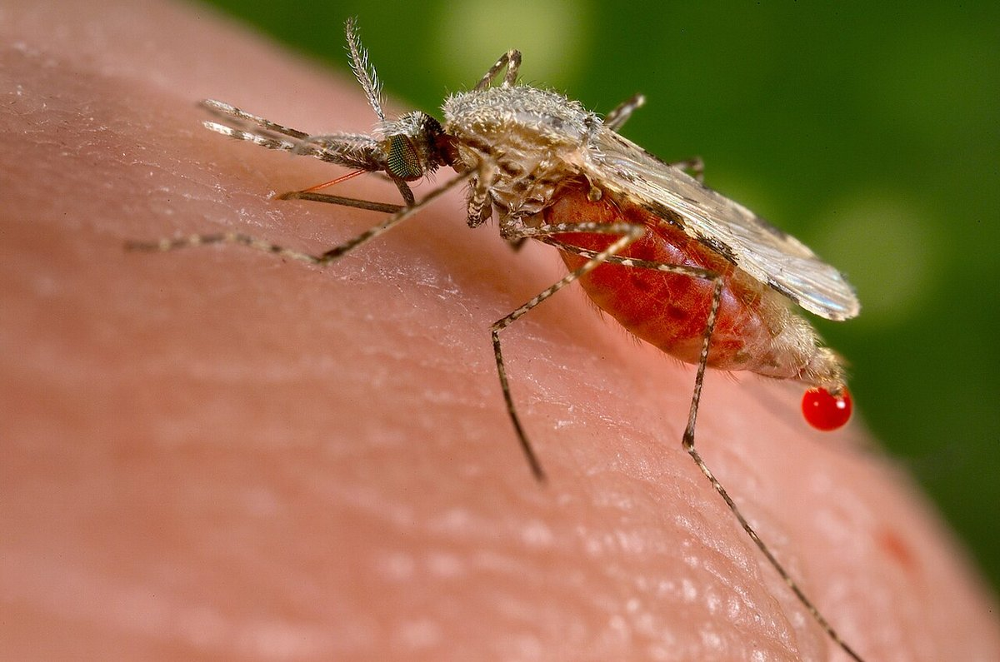
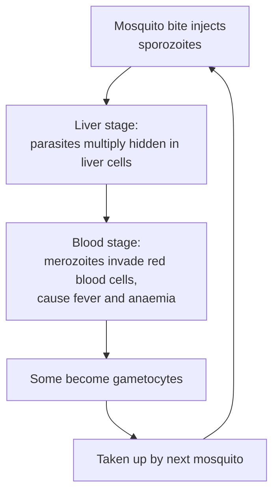

# Parasites and fungi

**Prerequisites:** [Cells and the chemistry of life](01-cells-and-the-chemistry-of-life.md)

*An Anopheles stephensi mosquito taking a blood meal; Anopheles mosquitoes transmit the Plasmodium parasites that cause malaria. Credit: Jim Gathany. License: Public domain. Source: [File:Anopheles stephensi.jpeg](https://commons.wikimedia.org/wiki/File:Anopheles_stephensi.jpeg).*

## Beyond bacteria and viruses

Viruses and bacteria cause most vaccine-preventable diseases, but two other groups of pathogens matter to this course: **parasites** (especially the protozoa that cause malaria) and, more briefly, **fungi**. They are eukaryotes, like us, which makes them harder to attack with drugs and, for decades, much harder to vaccinate against.

## Protozoa: the malaria parasite

Protozoa are single-celled eukaryotes. The most important for human health is *Plasmodium*, the cause of **malaria**. Five species infect humans; *P. falciparum* causes most deaths, mainly among young children in sub-Saharan Africa.

The life cycle explains why a malaria vaccine was so hard to make:

The parasite changes form at each stage, displays different proteins at each, hides inside cells, and varies its surface proteins to dodge antibodies. People in endemic areas who survive many infections develop partial immunity, but it is slow to build and wanes without re-exposure. Unlike measles, a single infection does not give lasting protection.

The first malaria vaccine recommended by the WHO, **RTS,S/AS01** (2021), targets the sporozoite's circumsporozoite protein, aiming to stop the parasite before it reaches the liver. A second, **R21/Matrix-M**, was recommended in 2023. Both give partial, waning protection that is still valuable where malaria is common; see [[malaria|malaria]] for the trial figures ([RTS,S Clinical Trials Partnership, *Lancet* 2015](https://doi.org/10.1016/S0140-6736(15)60721-8); [Datoo et al., *Lancet* 2024 (R21 trial)](https://doi.org/10.1016/S0140-6736(23)02511-4)).

## Helminths

Parasitic worms (helminths), such as hookworm and schistosomes, infect over a billion people. No human vaccine against a helminth is licensed. They are mentioned because chronic worm infection can blunt responses to some vaccines, one of several reasons a vaccine may work less well in one population than another.

## Fungi

Fungi (yeasts and moulds) mainly threaten people with weakened immune systems, such as those with advanced HIV, cancer chemotherapy or organ transplants. There are no licensed human vaccines against fungal infections. They matter here only for context: some vaccine-safety questions involve fungal products indirectly, because yeast (*Saccharomyces cerevisiae*) is used as a factory to make vaccine proteins. The hepatitis B vaccine and some HPV vaccines are produced in yeast cells, and trace yeast protein is listed as a possible residual. See [how vaccines are made](../immunology/vaccines/01-how-vaccines-work/12-how-vaccines-are-made.md).

## Vectors

Many parasites and some viruses are carried by **vectors**, usually insects. Mosquitoes carry malaria (*Anopheles*), and yellow fever, dengue and Zika (*Aedes*). Ticks carry tick-borne encephalitis. Controlling vectors with bed nets, insecticides and drainage is a major prevention method alongside vaccines; neither replaces the other. Vector-borne diseases cannot usually be eradicated by vaccinating humans, because the vector and often an animal reservoir keep the pathogen circulating. Yellow fever, for example, has a jungle cycle in monkeys.

## Why eukaryotic pathogens are hard targets

- **Complex life cycles** mean several stages with different antigens.
- **Antigenic variation**: parasites like *Plasmodium* and trypanosomes switch surface proteins.
- **Immune evasion**: hiding inside cells, suppressing immune responses.
- **Large genomes**: thousands of genes give many ways to adapt.

## Key ideas

- Parasites (protozoa and worms) and fungi are eukaryotes and harder to target than bacteria or viruses.
- Malaria's multi-stage life cycle and antigenic variation made vaccine development slow; two partially effective vaccines are now recommended by the WHO.
- Vectors such as mosquitoes spread several vaccine-preventable diseases; vector control and vaccination complement each other.
- Yeast is used to manufacture some vaccines, which is why yeast protein appears in some ingredient lists.

## Where this leads

- Next: [Infection and transmission](06-infection-and-transmission.md).
- Related: [[malaria|malaria]], [[yellow-fever|yellow fever]], [[dengue|dengue]].
