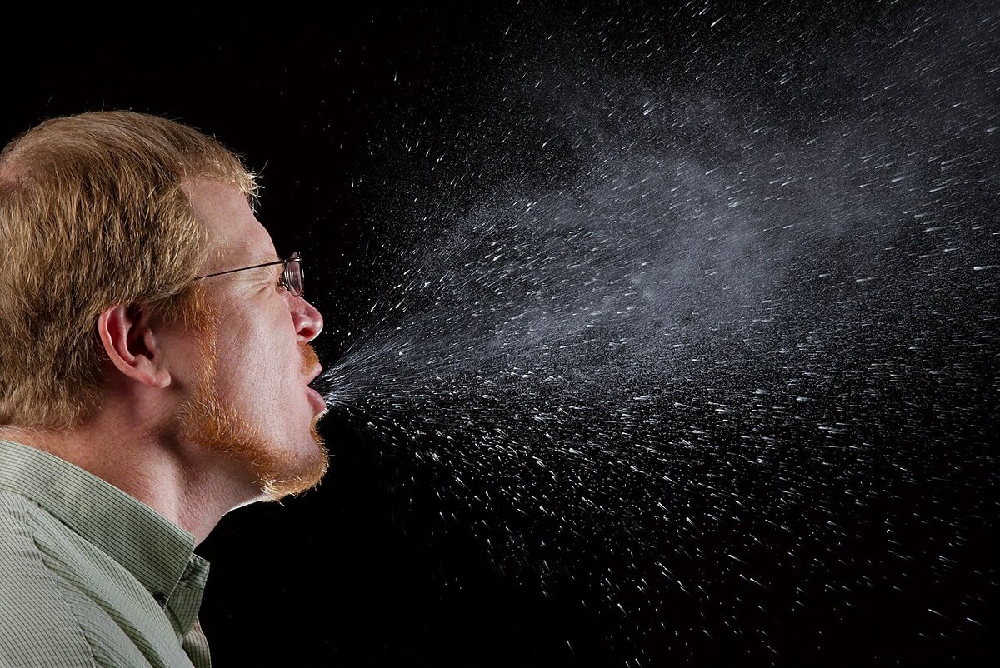
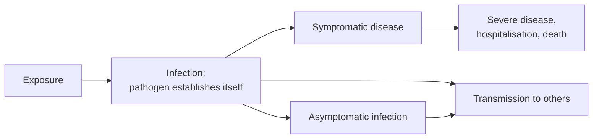

# Infection and transmission

**Prerequisites:** [Bacteria](02-bacteria.md); [Viruses](03-viruses.md)

*High-speed photograph of a sneeze, showing the spray of droplets that can carry respiratory pathogens. Credit: James Gathany. License: Public domain. Source: [File:Sneeze.JPG](https://commons.wikimedia.org/wiki/File:Sneeze.JPG).*

## From exposure to disease

Being exposed to a pathogen is not the same as being infected, and being infected is not the same as being ill. Each step can be described separately, and vaccines can act at several of them.

A vaccine might prevent infection altogether (sometimes called "sterilising" immunity), or allow infection but prevent symptoms, or allow symptoms but prevent severe disease, or reduce how much a person transmits. These are different outcomes and need different studies. Much argument about COVID-19 vaccines came from conflating them: the trials measured symptomatic disease, while public debate often asked about transmission. See [efficacy, effectiveness and waning](../epidemiology/13-efficacy-effectiveness-and-waning.md).

## Key terms

- **Incubation period**: time from infection to first symptoms (about 10 to 14 days for measles; days for influenza; 7 to 10 days on average for tetanus, but it can range from 3 to 21 days).
- **Infectious period**: when a person can spread the pathogen. For measles this starts about four days *before* the rash, which is one reason it spreads so well.
- **Asymptomatic** and **pre-symptomatic** transmission: spread by people who have no symptoms or not yet. Polio is a striking case: around 70% of infections cause no symptoms and fewer than 1% cause paralysis, according to the WHO, so for every paralysed child many silent infections are spreading the virus.
- **Virulence**: how much harm a pathogen tends to do.
- **Infectious dose**: how many organisms it takes to cause infection.
- **Reservoir**: where a pathogen lives between outbreaks (humans only, animals, soil, water).

## Routes of transmission

| Route | How | Examples |
|---|---|---|
| Airborne / aerosol | Fine particles that hang in air | Measles, chickenpox, TB, SARS-CoV-2 (substantially) |
| Respiratory droplets and contact | Larger droplets, close contact | Pertussis, influenza, diphtheria, meningococcus |
| Faecal–oral | Contaminated hands, food or water | Polio, rotavirus, hepatitis A, cholera, typhoid |
| Blood and body fluids | Sex, needles, birth | Hepatitis B, HPV (skin-to-skin genital contact) |
| Vector-borne | Insect bite | Yellow fever, dengue, malaria, Japanese encephalitis |
| Animal bite | Saliva | Rabies |
| Environmental | Spores in soil entering wounds | Tetanus |
| Mother to child | Pregnancy, birth, breastfeeding | Rubella (congenital rubella syndrome), hepatitis B |

The route shapes which interventions work. Clean water nearly ended cholera and typhoid in rich countries before vaccines existed; it did little against measles, which is airborne. The pattern explains a common argument, examined in [[historical-mortality-decline-argument|the "mortality was already falling" debate]]: sanitation and nutrition did reduce deaths from many infections, but airborne childhood infections such as measles kept infecting nearly every child until vaccination.

## Host factors

Whether infection causes severe disease also depends on the host: age (newborns and the elderly are most vulnerable), immune status, nutrition (vitamin A deficiency makes measles far deadlier), pregnancy, and genetics. This is why schedules target particular ages and groups, covered in [how schedules are built](../immunology/vaccines/05-schedules/01-how-schedules-are-built.md).

## Contagiousness varies hugely

Measles is among the most contagious human diseases: the CDC states that up to 9 out of 10 susceptible close contacts of a person with measles will become infected. Tetanus is not contagious at all. Between them lie the others. The next branch, [transmission and the reproduction number](../epidemiology/03-transmission-and-the-reproduction-number.md), turns this into numbers.

## Key ideas

- Exposure, infection, symptomatic disease, severe disease and transmission are separate steps; vaccines may affect some more than others.
- Incubation and infectious periods, asymptomatic spread and reservoirs shape how diseases spread.
- The route of transmission determines which interventions work: sanitation for faecal–oral, vaccination especially for airborne diseases.
- Host factors such as age, nutrition and immune status determine severity.

## Where this leads

- Next branch: [Immunology](../immunology/01-the-immune-system-at-a-glance.md).
- Then: [Epidemiology](../epidemiology/01-what-epidemiology-is.md).
