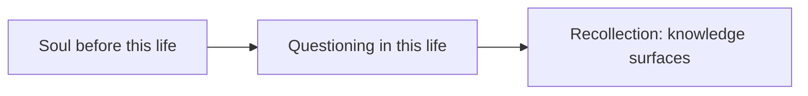

# Recollection (*anamnesis*)

**Prerequisites:** [Knowledge and opinion](knowledge-and-opinion.md) and the [*Meno*](../../history/ancient/greek/texts/meno.md)

In the [*Meno*](../../history/ancient/greek/texts/meno.md), the paradox of inquiry — you cannot search for what you do not know, because you would not recognize it — is answered by a myth of the soul's immortality and by a demonstration: an enslaved boy, questioned, recovers a geometric result. Learning is recollection of what the soul already knew. The [*Phaedo*](../../history/ancient/greek/texts/phaedo.md) ties the same idea to the [Forms](../metaphysics/the-forms.md): we compare sensibles with Equality itself, which we never saw with the eyes.

Whether this is a literal theory of prenatal knowledge or a picture of how insight can be midwifed is already a question inside the reading tradition. Either way, the first-principles work is to explain how inquiry is possible, and why a question can bring out more than the teacher puts in.

## Key ideas

- Recollection is Plato's reply to the paradox of inquiry.
- The *Meno*'s geometry scene and the *Phaedo*'s Forms are the two main texts.
- It can be read literally or as a picture of midwifed insight.

## Where this leads

- [The Forms](../metaphysics/the-forms.md)
- Texts: [*Meno*](../../history/ancient/greek/texts/meno.md), [*Phaedo*](../../history/ancient/greek/texts/phaedo.md)
- Glossary: [*anamnesis*](../../glossary/greek/anamnesis.md)
