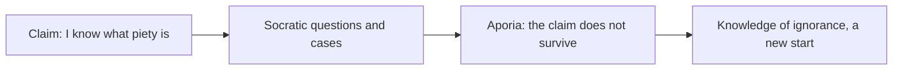

# Elenchus and *aporia*

**Prerequisites:** [Socrates](../../history/ancient/greek/thinkers/socrates.md)

*Bust of Aristotle. Marble, Roman copy after a Greek bronze original by Lysippos from 330 BC; the alabaster mantle is a modern addition. Credit: After Lysippos. License: Public domain. Source: [File:Aristotle Altemps Inv8575.jpg](https://commons.wikimedia.org/wiki/File:Aristotle_Altemps_Inv8575.jpg).*
The *elenchus* is [Socrates](../../history/ancient/greek/thinkers/socrates.md)' method of cross-examination: ask for a definition, test it with cases and consequences, and often leave the interlocutor in *aporia* — puzzlement, a path that has run out. The [*Euthyphro*](../../history/ancient/greek/texts/euthyphro.md) is a clean short example; the [*Apology*](../../history/ancient/greek/texts/apology.md) presents the method as a service to the god and as the meaning of "knowledge of ignorance."

The method looks merely negative. Its ethical point is that a person who cannot survive questions about virtue does not know what they thought they knew, and that this discovery is a needed start, not a humiliation for its own sake. Later Plato will also want constructive theory; [Aristotle](../../history/ancient/greek/thinkers/aristotle.md) will formalize argument in the [*Organon*](../../history/ancient/greek/texts/organon.md). The *elenchus* remains the image of philosophy as a conversation that can take something away from you.

## Working the idea

The Socratic *elenchus* is a practice of refutation by question and answer. An interlocutor offers a definition or a confident claim (piety is what the gods love; virtue is teachable; it is better to wrong than to be wronged). Socrates asks for consequences, introduces a further admission, and shows that the admissions cannot all be kept. The typical ending of an early dialogue is *aporia*: not a tidy new definition, but a shared stuckness. That stuckness is not simply failure. It is a purging of the pretense of knowledge, a necessary first step if genuine search is to begin.

Whether Socrates himself holds positive doctrines in these dialogues, or only a method, is a standing question. Whether the *elenchus* can, in principle, deliver a stable definition, or only knock down the bad ones, is another. Plato's later work does not abandon questioning, but it adds myth, dialectic of a more constructive kind, and, sometimes, a teacher who speaks at length. So "the Socratic method" in a modern classroom — the professor already knows and nudges students toward a prepared answer — is a pale, often inverted, image of the early dialogues' risk.

Use the idea as a reading tool. Map the interlocutor's claims, mark the turning question, and state the contradiction in one sentence. Then notice your own frustration at the lack of a final answer, and treat that frustration as part of the text's design. *Aporia* is a pedagogic device and a philosophical claim: some subjects cannot be honestly begun until a false fluency has been lost. Comparison with Confucian correction, or with Mohist and Aristotelian techniques of testing a reason, should wait until this dramatic pattern is clear in a few dialogues, not only in a summary.

## Key ideas

- *Elenchus* tests definitions; *aporia* is a typical, and useful, ending.
- The ethical yield is knowledge of ignorance, not a finished theory in the early dialogues.
- It is the method of the trial dialogues and the image of Socratic philosophy.

## Where this leads

- [Virtue as knowledge](../ethics/virtue-as-knowledge.md)
- Texts: [*Euthyphro*](../../history/ancient/greek/texts/euthyphro.md), [*Apology*](../../history/ancient/greek/texts/apology.md)
- Glossary: [*elenchus*](../../glossary/greek/elenchus.md), [*aporia*](../../glossary/greek/aporia.md)
