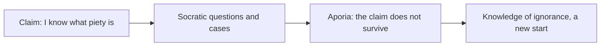

# Elenchus and *aporia*

**Prerequisites:** [Socrates](../../history/ancient/greek/thinkers/socrates.md)

The *elenchus* is [Socrates](../../history/ancient/greek/thinkers/socrates.md)' method of cross-examination: ask for a definition, test it with cases and consequences, and often leave the interlocutor in *aporia* — puzzlement, a path that has run out. The [*Euthyphro*](../../history/ancient/greek/texts/euthyphro.md) is a clean short example; the [*Apology*](../../history/ancient/greek/texts/apology.md) presents the method as a service to the god and as the meaning of "knowledge of ignorance."

The method looks merely negative. Its ethical point is that a person who cannot survive questions about virtue does not know what they thought they knew, and that this discovery is a needed start, not a humiliation for its own sake. Later Plato will also want constructive theory; [Aristotle](../../history/ancient/greek/thinkers/aristotle.md) will formalize argument in the [*Organon*](../../history/ancient/greek/texts/organon.md). The *elenchus* remains the image of philosophy as a conversation that can take something away from you.

## Key ideas

- *Elenchus* tests definitions; *aporia* is a typical, and useful, ending.
- The ethical yield is knowledge of ignorance, not a finished theory in the early dialogues.
- It is the method of the trial dialogues and the image of Socratic philosophy.

## Where this leads

- [Virtue as knowledge](../ethics/virtue-as-knowledge.md)
- Texts: [*Euthyphro*](../../history/ancient/greek/texts/euthyphro.md), [*Apology*](../../history/ancient/greek/texts/apology.md)
- Glossary: [*elenchus*](../../glossary/greek/elenchus.md), [*aporia*](../../glossary/greek/aporia.md)
