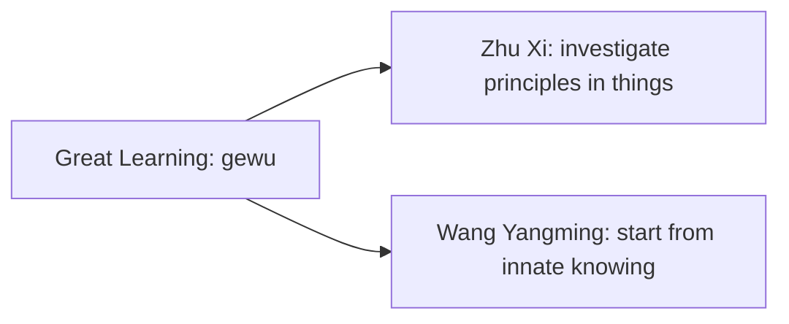

# Investigation of things (*gewu*)

**Prerequisites:** [Great Learning](../../history/ancient/chinese/texts/great-learning.md) and [Zhu Xi](../../history/imperial/chinese/thinkers/zhu-xi.md)

*The teaching Confucius. Portrait by Wu Daozi, 685-758, Tang Dynasty. Credit: Wu Daozi, 685-758, Tang Dynasty.. License: Public domain. Source: [File:Confucius Tang Dynasty.jpg](https://commons.wikimedia.org/wiki/File:Confucius_Tang_Dynasty.jpg).*
The short phrase *gewu*, "investigating things" or "arriving at things," opens the [*Great Learning*](../../history/ancient/chinese/texts/great-learning.md)'s chain from inner work to peace under Heaven. What it *means* became a Song–Ming battlefield. [Zhu Xi](../../history/imperial/chinese/thinkers/zhu-xi.md) reads it as the extension of knowledge by examining principles (*li*) in affairs and texts — an outward-and-inward discipline of study. [Wang Yangming](../../history/imperial/chinese/thinkers/wang-yangming.md) thinks that starting with outer things postpones the work; [innate knowing](../../glossary/chinese/liangzhi.md) is already present, and real knowledge is already [unified with action](../../glossary/chinese/zhixing-heyi.md).

The ancient phrase is brief; the later argument is the lesson. First principles here include this: a curriculum can turn on a single verb, and two honest Confucians can disagree about where moral knowing starts.

## Working the idea

*Gewu* — often translated "investigation of things" — comes into later Confucian epistemology through the *Great Learning*, where the chain of cultivation runs from investigating things and extending knowledge to sincerity, a rightly ordered heart, self-cultivation, family, and, eventually, the state. The phrase is brief in the ancient text and became, centuries later, a battlefield. That later fight is part of why the term belongs in an ancient-and-imperial philosophy path, but the first job is to see what problem it names: how does moral knowledge get a grip on the world, rather than remaining a slogan in the mind?

Zhu Xi, in the Song, reads *gewu* as a disciplined pattern-seeking: li (principle, pattern) is in things and in the mind, and the student investigates until the pattern is clear and knowledge is complete. The investigation is not "science" in a modern laboratory sense, though it can include attentive empirical regard. It is a moral-intellectual work aimed at a coherent grasp of how things should be responded to. Wang Yangming, later, objects that this externalizing search can postpone action forever. For him the heart-mind already has li, and knowledge and action are one; to investigate is to correct the heart in the midst of affairs, not to catalogue an outer world first.

You do not have to pick a winner to use the idea well. Use it as a question you can put to any Confucian text: what, exactly, is the student supposed to *look at*, and how would they know they had done it? The *Great Learning* and *Doctrine of the Mean* give you the short canonical prompts. Zhu Xi and Wang Yangming show how a short prompt can generate two rival pedagogies. A Greek comparison (Aristotle's movement from particulars to principles, or the Platonic turn from visible things to forms) is possible later, once the Chinese debate has been heard in its own terms.

## Key ideas

- *Gewu* is a brief ancient phrase made decisive by Zhu Xi's curriculum.
- Zhu Xi and Wang Yangming disagree on where investigation starts.
- The debate is about knowledge and action, not about dropping cultivation.

## Where this leads

- Thinkers: [Zhu Xi](../../history/imperial/chinese/thinkers/zhu-xi.md), [Wang Yangming](../../history/imperial/chinese/thinkers/wang-yangming.md)
- Glossary: [*liangzhi*](../../glossary/chinese/liangzhi.md)
