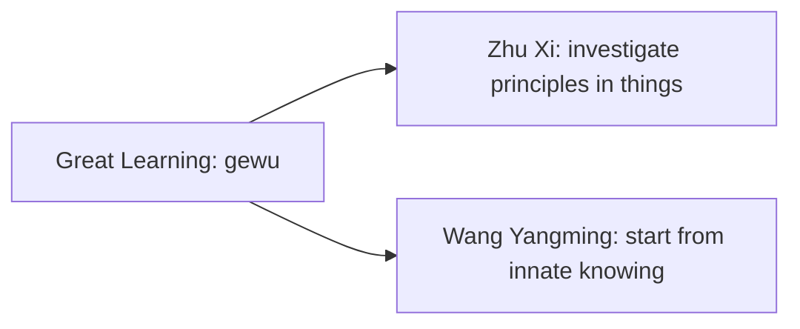

# Investigation of things (*gewu*)

**Prerequisites:** [Great Learning](../../history/ancient/chinese/texts/great-learning.md) and [Zhu Xi](../../history/imperial/chinese/thinkers/zhu-xi.md)

The short phrase *gewu*, "investigating things" or "arriving at things," opens the [*Great Learning*](../../history/ancient/chinese/texts/great-learning.md)'s chain from inner work to peace under Heaven. What it *means* became a Song–Ming battlefield. [Zhu Xi](../../history/imperial/chinese/thinkers/zhu-xi.md) reads it as the extension of knowledge by examining principles (*li*) in affairs and texts — an outward-and-inward discipline of study. [Wang Yangming](../../history/imperial/chinese/thinkers/wang-yangming.md) thinks that starting with outer things postpones the work; [innate knowing](../../glossary/chinese/liangzhi.md) is already present, and real knowledge is already [unified with action](../../glossary/chinese/zhixing-heyi.md).

The ancient phrase is brief; the later argument is the lesson. First principles here include this: a curriculum can turn on a single verb, and two honest Confucians can disagree about where moral knowing starts.

## Key ideas

- *Gewu* is a brief ancient phrase made decisive by Zhu Xi's curriculum.
- Zhu Xi and Wang Yangming disagree on where investigation starts.
- The debate is about knowledge and action, not about dropping cultivation.

## Where this leads

- Thinkers: [Zhu Xi](../../history/imperial/chinese/thinkers/zhu-xi.md), [Wang Yangming](../../history/imperial/chinese/thinkers/wang-yangming.md)
- Glossary: [*liangzhi*](../../glossary/chinese/liangzhi.md)
