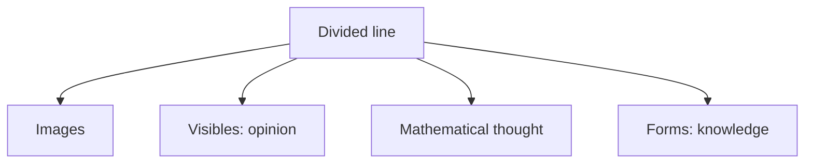

# Knowledge and opinion

**Prerequisites:** [Plato](../../history/ancient/greek/thinkers/plato.md) and [the Forms](../metaphysics/the-forms.md)

*Bust of Aristotle. Marble, Roman copy after a Greek bronze original by Lysippos from 330 BC; the alabaster mantle is a modern addition. Credit: After Lysippos. License: Public domain. Source: [File:Aristotle Altemps Inv8575.jpg](https://commons.wikimedia.org/wiki/File:Aristotle_Altemps_Inv8575.jpg).*
[Plato](../../history/ancient/greek/thinkers/plato.md) distinguishes *episteme* (knowledge) from *doxa* (opinion or belief). In the [*Republic*](../../history/ancient/greek/texts/republic.md), the distinction tracks objects: knowledge grasps stable Forms; opinion tracks the changing visibles. The divided line ranks images, ordinary objects, mathematical thought, and dialectic. The [*Meno*](../../history/ancient/greek/texts/meno.md) offers a more modest cut: knowledge is true opinion "tied down" by an account, like Daedalus's statues. The [*Theaetetus*](../../history/ancient/greek/texts/theaetetus.md) tries, and fails, to define knowledge as perception, as true opinion, and as true opinion plus a *logos* — a founding *aporia* of epistemology.

The first-principles point is not a slogan ("knowledge is better"). It is that a changing world and a demand for stable truth create a problem, and that "I believe truly" may still not be "I know."

## Working the idea

Plato's distinction between *epistēmē* (knowledge) and *doxa* (opinion, belief, seeming) is not the same as the modern contrast between "certain science" and "mere taste." In the *Republic*, they belong to different cognitive powers and, famously, to different kinds of object: knowledge is of what is (the forms), opinion of what both is and is not, the changing visible world. The divided line and the cave image the climb from shadows and images, through trustworthy perception and mathematical thought, to understanding. In the *Meno* and the *Theaetetus*, the contrast is also about stability and account: a true opinion can be as practically useful as knowledge (the road to Larisa) until it wanders off, and the *Theaetetus* tests, without a final official doctrine, whether knowledge is perception, or true opinion, or true opinion with an account.

Aristotle will redraw the map: knowledge in the strict demonstrative sense is of universals and necessities, but he gives experience, craft, and practical wisdom their own dignities, and he will not accept a separate realm of forms as the only knowable items. Later epistemology often recasts the whole problem as "justified true belief" plus a Gettier worry. That later frame can be brought into conversation with the *Theaetetus*, but it should not replace Plato's own concern with the *objects* and with the kind of soul that can have them.

When a text praises knowledge over opinion, ask: is the complaint that opinions are false, that they are unstable, that they lack an explanatory account, or that they are aimed at the wrong objects? The remedies will differ. A Socratic demand for a definition, a Platonic turn to forms, and an Aristotelian demand for demonstration are three such remedies, not three names for one.

## Key ideas

- Knowledge and opinion are distinguished by object, by stability, and by whether a true view is "tied down."
- The *Theaetetus* leaves the definition open and still sets the later agenda.
- The distinction is a reply to flux as much as a piece of psychology.

## Where this leads

- [Anamnesis](anamnesis.md), [elenchus and aporia](elenchus-and-aporia.md)
- Texts: [*Meno*](../../history/ancient/greek/texts/meno.md), [*Theaetetus*](../../history/ancient/greek/texts/theaetetus.md), [*Republic*](../../history/ancient/greek/texts/republic.md)
