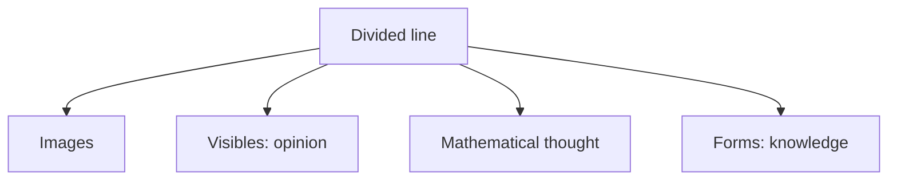

# Knowledge and opinion

**Prerequisites:** [Plato](../../history/ancient/greek/thinkers/plato.md) and [the Forms](../metaphysics/the-forms.md)

[Plato](../../history/ancient/greek/thinkers/plato.md) distinguishes *episteme* (knowledge) from *doxa* (opinion or belief). In the [*Republic*](../../history/ancient/greek/texts/republic.md), the distinction tracks objects: knowledge grasps stable Forms; opinion tracks the changing visibles. The divided line ranks images, ordinary objects, mathematical thought, and dialectic. The [*Meno*](../../history/ancient/greek/texts/meno.md) offers a more modest cut: knowledge is true opinion "tied down" by an account, like Daedalus's statues. The [*Theaetetus*](../../history/ancient/greek/texts/theaetetus.md) tries, and fails, to define knowledge as perception, as true opinion, and as true opinion plus a *logos* — a founding *aporia* of epistemology.

The first-principles point is not a slogan ("knowledge is better"). It is that a changing world and a demand for stable truth create a problem, and that "I believe truly" may still not be "I know."

## Key ideas

- Knowledge and opinion are distinguished by object, by stability, and by whether a true view is "tied down."
- The *Theaetetus* leaves the definition open and still sets the later agenda.
- The distinction is a reply to flux as much as a piece of psychology.

## Where this leads

- [Anamnesis](anamnesis.md), [elenchus and aporia](elenchus-and-aporia.md)
- Texts: [*Meno*](../../history/ancient/greek/texts/meno.md), [*Theaetetus*](../../history/ancient/greek/texts/theaetetus.md), [*Republic*](../../history/ancient/greek/texts/republic.md)
