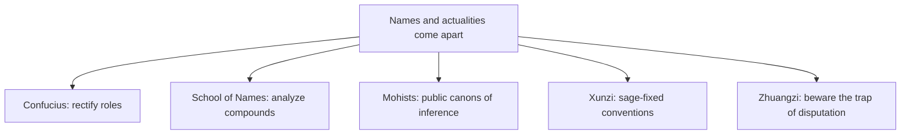

# Names and actuality

**Prerequisites:** [Chinese foundational concepts](../../history/ancient/chinese/01-foundational-concepts.md)

A recurring early Chinese problem is the fit between **names** (*ming*) and **actualities** or stuffs (*shi*). [Confucius](../../history/ancient/chinese/thinkers/confucius.md) would "rectify names" so that a ruler is a ruler and a father a father; when words and roles come apart, government cannot hold. The [School of Names](../../history/ancient/chinese/thinkers/gongsun-long-and-hui-shi.md) turns the same terrain into technical paradox ("a white horse is not a horse"). The later [Mohists](../logic/later-mohist-canons.md) try to make standards of naming and inference public. [Xunzi](../../history/ancient/chinese/thinkers/xunzi.md) offers a theory of names as conventional but not arbitrary, to be fixed by sages and used without trickery. [Zhuangzi](../../history/ancient/chinese/thinkers/zhuangzi.md) distrusts the whole hope of a final standard.

This is epistemology and political philosophy at once: a name is a standard, and a standard is a way of running a world.

## Key ideas

- The fit of names to actualities is a shared early Chinese problem.
- Confucian, Mohist, Sophist-like, and Daoist answers differ sharply.
- Naming is political as well as logical.

## Where this leads

- [Paradox and the School of Names](../logic/paradox-and-the-school-of-names.md), [later Mohist canons](../logic/later-mohist-canons.md)
- Glossary: [*zhengming*](../../glossary/chinese/zhengming.md)
