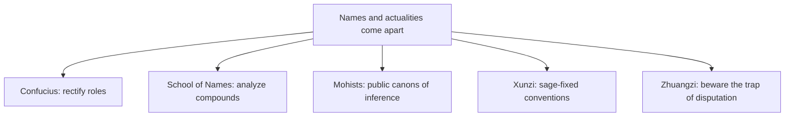

# Names and actuality

**Prerequisites:** [Chinese foundational concepts](../../history/ancient/chinese/01-foundational-concepts.md)

*The teaching Confucius. Portrait by Wu Daozi, 685-758, Tang Dynasty. Credit: Wu Daozi, 685-758, Tang Dynasty.. License: Public domain. Source: [File:Confucius Tang Dynasty.jpg](https://commons.wikimedia.org/wiki/File:Confucius_Tang_Dynasty.jpg).*
A recurring early Chinese problem is the fit between **names** (*ming*) and **actualities** or stuffs (*shi*). [Confucius](../../history/ancient/chinese/thinkers/confucius.md) would "rectify names" so that a ruler is a ruler and a father a father; when words and roles come apart, government cannot hold. The [School of Names](../../history/ancient/chinese/thinkers/gongsun-long-and-hui-shi.md) turns the same terrain into technical paradox ("a white horse is not a horse"). The later [Mohists](../logic/later-mohist-canons.md) try to make standards of naming and inference public. [Xunzi](../../history/ancient/chinese/thinkers/xunzi.md) offers a theory of names as conventional but not arbitrary, to be fixed by sages and used without trickery. [Zhuangzi](../../history/ancient/chinese/thinkers/zhuangzi.md) distrusts the whole hope of a final standard.

This is epistemology and political philosophy at once: a name is a standard, and a standard is a way of running a world.

## Working the idea

The concern with *zhengming*, the rectification of names, and more broadly with the fit between names (*ming*) and actualities (*shi*), runs through Confucian, Mohist, and "School of Names" texts in different keys. In the *Analects*, Confucius says that if names are not correct, speech will not be smooth, affairs will not be accomplished, ritual and music will not flourish, and punishments will miss their mark. A name here is not only a label. It is a role-word: "ruler," "father," "son." To rectify names is to make the person and the conduct answer to what the name requires, and to refuse to call a failing ruler by a title that whitewashes the failure.

Mohist and later technical writings push the same pair toward standards and disputation: a name should stay with its object; distinctions should not slide in the middle of an argument; a reason should be testable. The School of Names, by contrast, shows how names can be pressed until common sense screams, which is a way of asking what a correct name *is*. Xunzi, in his essay on names, treats them as conventional yet not arbitrary once a king has fixed them for the sake of social order — a third stance, both political and linguistic.

Work the idea by taking one role-name and one kind-name ("horse," "white horse") and asking what would count as getting them right in each tradition. Confucian rightness is often moral and ritual; Mohist rightness is often a matter of reliable distinction in the service of benefit; the paradoxers isolate the mechanics of reference. None of this is exactly the Greek debate about nature and convention in names (Plato's *Cratylus*), but the comparison becomes fair once the Chinese problem is seen as practical and political, not as a narrow theory of meaning in a modern linguistic sense.

## Key ideas

- The fit of names to actualities is a shared early Chinese problem.
- Confucian, Mohist, Sophist-like, and Daoist answers differ sharply.
- Naming is political as well as logical.

## Where this leads

- [Paradox and the School of Names](../logic/paradox-and-the-school-of-names.md), [later Mohist canons](../logic/later-mohist-canons.md)
- Glossary: [*zhengming*](../../glossary/chinese/zhengming.md)
