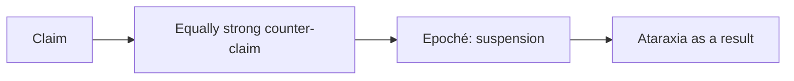

# Skepticism and *epoché*

**Prerequisites:** [Pyrrho](../../history/ancient/greek/thinkers/pyrrho.md) and [Sextus Empiricus](../../history/ancient/greek/thinkers/sextus-empiricus.md)

Hellenistic skepticism is not, in its careful Pyrrhonian form, the dogma that knowledge is impossible. [Sextus Empiricus](../../history/ancient/greek/thinkers/sextus-empiricus.md) treats that dogma as itself a claim the skeptic will not assert. The method is to set argument against argument until they balance (*isosthenia*), then to **suspend judgment** (*[epoché](../../glossary/greek/epoche.md)*) about what is non-evident. [*Ataraxia*](../ethics/ataraxia-and-apatheia.md) follows "like a shadow." Meanwhile one lives by appearances, custom, nature, and the arts.

[Pyrrho](../../history/ancient/greek/thinkers/pyrrho.md) is the shadowy founder; the Academic skeptics attacked Stoic certainty from inside Plato's school. The shared contrast is with [Stoic](../../history/ancient/greek/thinkers/zeno-of-citium.md) and [Epicurean](../../history/ancient/greek/thinkers/epicurus.md) "dogmatic" routes to the same prize, tranquility.

## Key ideas

- Pyrrhonian skepticism keeps investigating; it does not assert that knowledge is impossible.
- *Epoché* is suspension of judgment; tranquility is a result, not a forced target.
- Appearances and custom still guide life.

## Where this leads

- Thinkers: [Pyrrho](../../history/ancient/greek/thinkers/pyrrho.md), [Sextus Empiricus](../../history/ancient/greek/thinkers/sextus-empiricus.md)
- Glossary: [*epoche*](../../glossary/greek/epoche.md)
