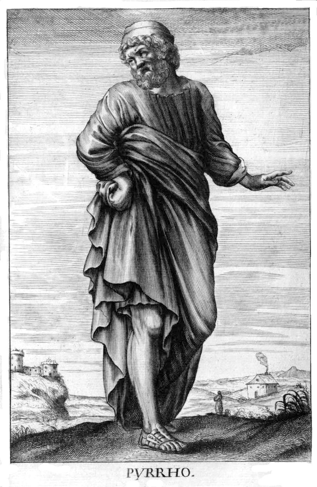

# Skepticism and *epoché*

**Prerequisites:** [Pyrrho](../../history/ancient/greek/thinkers/pyrrho.md) and [Sextus Empiricus](../../history/ancient/greek/thinkers/sextus-empiricus.md)

*Pyrrho, ancient Greek philosopher. From Thomas Stanley, (1655), The history of philosophy: containing the lives, opinions, actions and Discourses of the… Credit: Unknown authorUnknown author. License: Public domain. Source: [File:Pyrrho in Thomas Stanley History of Philosophy.jpg](https://commons.wikimedia.org/wiki/File:Pyrrho_in_Thomas_Stanley_History_of_Philosophy.jpg).*
Hellenistic skepticism is not, in its careful Pyrrhonian form, the dogma that knowledge is impossible. [Sextus Empiricus](../../history/ancient/greek/thinkers/sextus-empiricus.md) treats that dogma as itself a claim the skeptic will not assert. The method is to set argument against argument until they balance (*isosthenia*), then to **suspend judgment** (*[epoché](../../glossary/greek/epoche.md)*) about what is non-evident. [*Ataraxia*](../ethics/ataraxia-and-apatheia.md) follows "like a shadow." Meanwhile one lives by appearances, custom, nature, and the arts.

[Pyrrho](../../history/ancient/greek/thinkers/pyrrho.md) is the shadowy founder; the Academic skeptics attacked Stoic certainty from inside Plato's school. The shared contrast is with [Stoic](../../history/ancient/greek/thinkers/zeno-of-citium.md) and [Epicurean](../../history/ancient/greek/thinkers/epicurus.md) "dogmatic" routes to the same prize, tranquility.

## Working the idea

Greek skepticism is not one mood of doubt. It is at least two practices, and they aim at different things. Academic skepticism, associated with the later Academy after Arcesilaus and Carneades, argues *against* the Stoic claim that some impressions are so clear that they cannot be false. The Academic can be a fierce dialectician: for any case, a counter-case. Pyrrhonism, as Sextus Empiricus presents it, is not a doctrine that "nothing can be known." It is a way of life that uses contrasts, relativity, and disagreement to bring about *epochē*, suspension, and then *ataraxia*, a quieting of the disturbance that comes from having to defend a position.

That distinction matters because a modern reader often imports a later problem — Descartes' methodological doubt, or a worry about the external world — and then finds the ancients disappointing. Sextus is not trying to rebuild knowledge on a foundation. He is trying to show that the dogmatic philosopher, the one who claims to have grasped how things really are, keeps failing by the dogmatist's own standards, and that the skeptic can still live, follow appearances, and act on ordinary customs without that claim. The tropes (modes) of Aenesidemus and Agrippa are tools for this: disagreement, regress, relativity, hypothesis, and circularity. They are not a single "proof that knowledge is impossible."

*Epochē* is therefore not apathy and not cynicism. The skeptic still eats, flees danger, and follows the laws of a city. What is suspended is the extra step of saying "this is how things *are* by nature." Whether this is a coherent stance, or a hidden doctrine in disguise, is a standing scholarly quarrel. Read Sextus first, slowly, and notice how often he describes an outcome (quiet) rather than arguing for a thesis. Then compare the Stoic and Epicurean promises of a similar calm, reached by the opposite route: a true account of nature.

## Key ideas

- Pyrrhonian skepticism keeps investigating; it does not assert that knowledge is impossible.
- *Epoché* is suspension of judgment; tranquility is a result, not a forced target.
- Appearances and custom still guide life.

## Where this leads

- Thinkers: [Pyrrho](../../history/ancient/greek/thinkers/pyrrho.md), [Sextus Empiricus](../../history/ancient/greek/thinkers/sextus-empiricus.md)
- Glossary: [*epoche*](../../glossary/greek/epoche.md)
