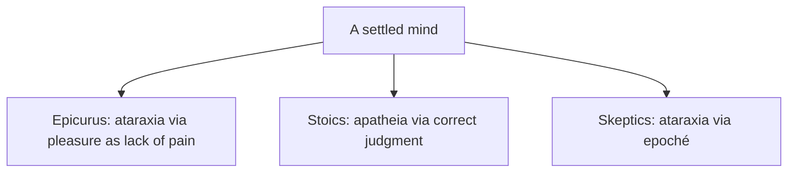

# *Ataraxia* and *apatheia*

**Prerequisites:** [Hellenistic schools](../../history/ancient/greek/06-hellenistic-schools.md)

*Bust of Aristotle. Marble, Roman copy after a Greek bronze original by Lysippos from 330 BC; the alabaster mantle is a modern addition. Credit: After Lysippos. License: Public domain. Source: [File:Aristotle Altemps Inv8575.jpg](https://commons.wikimedia.org/wiki/File:Aristotle_Altemps_Inv8575.jpg).*
Hellenistic ethics often aims at a settled condition of mind. **[*Ataraxia*](../../glossary/greek/ataraxia.md)** is freedom from disturbance, the prize [Epicurus](../../history/ancient/greek/thinkers/epicurus.md) and the [Skeptics](../../history/ancient/greek/thinkers/sextus-empiricus.md) both claim, by different routes (sorted desires and a physics without fear; [suspension of judgment](../epistemology/skepticism-and-epoche.md)). **[*Apatheia*](../../glossary/greek/apatheia.md)** is the [Stoic](../../history/ancient/greek/thinkers/zeno-of-citium.md) ideal: not numbness, but not being enslaved by passions, which are analyzed as false judgments about [indifferents](../../glossary/greek/adiaphora.md).

The shared first-principles question is: what would a mind look like that is no longer thrown about by fortune, fear of death, and social noise? The schools disagree about physics, about whether virtue is the only good, and about whether one should assent to a picture of the world or suspend.

## Working the idea

Hellenistic ethics converges on a promise of a settled condition — *ataraxia* (un-disturbedness) for Pyrrhonists and Epicureans, *apatheia* (freedom from the passions, in a technical sense) for Stoics — and then disagrees about the route and about what must be given up. It helps to keep the words from sliding into modern "apathy" or a numb peace. *Ataraxia* is a quiet of the soul that still allows ordinary action. *Apatheia* is not the death of feeling; in Stoic theory the passions (*pathē*) are false value-judgments, and in their place stand good affective states (*eupatheiai*) such as rational joy and caution.

Epicurus reaches quiet by trimming desire. Natural and necessary desires (food, shelter, basic friendship) can be satisfied simply; vain desires (fame, luxury without limit) cannot, and so they should be dropped. Fear of the gods and of death are treated with a physical theory: the gods, properly understood, do not manage our weather, and death is nothing to us because there is no subject left to suffer it. The Pyrrhonist reaches a similar-sounding quiet by a different door, without that physics: suspend the dogmatic claim, and the disturbance of having to defend it relaxes. The Stoic refuses to make pleasure or the absence of pain the good, and relocates the good entirely in virtue, so that the world can take back health and status without taking back the person.

When you read across the schools, do not only ask which promise you like. Ask what each school thinks *causes* disturbance — false belief about the gods, unmeasured desire, or the insistence that externals are truly good — and what practice would remove that cause. Then test the cost. A calm bought by calling a bereavement an indifferent is not the same calm as one bought by lowering the ceiling of desire, and neither is the same as skeptical suspension. The words can look like synonyms in a glossary; they are not synonyms in a life.

## Key ideas

- *Ataraxia* and *apatheia* are related but not identical ideals of a settled mind.
- Epicureans, Stoics, and Skeptics claim tranquility by different methods.
- Passions, in the Stoa, are judgments, not mere storms of feeling.

## Where this leads

- [Living according to nature](living-according-to-nature.md)
- Thinkers: [Epicurus](../../history/ancient/greek/thinkers/epicurus.md), [Epictetus](../../history/ancient/greek/thinkers/epictetus.md)
- Glossary: [*ataraxia*](../../glossary/greek/ataraxia.md), [*apatheia*](../../glossary/greek/apatheia.md)
