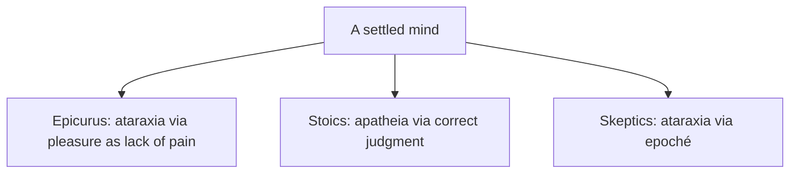

# *Ataraxia* and *apatheia*

**Prerequisites:** [Hellenistic schools](../../history/ancient/greek/06-hellenistic-schools.md)

Hellenistic ethics often aims at a settled condition of mind. **[*Ataraxia*](../../glossary/greek/ataraxia.md)** is freedom from disturbance, the prize [Epicurus](../../history/ancient/greek/thinkers/epicurus.md) and the [Skeptics](../../history/ancient/greek/thinkers/sextus-empiricus.md) both claim, by different routes (sorted desires and a physics without fear; [suspension of judgment](../epistemology/skepticism-and-epoche.md)). **[*Apatheia*](../../glossary/greek/apatheia.md)** is the [Stoic](../../history/ancient/greek/thinkers/zeno-of-citium.md) ideal: not numbness, but not being enslaved by passions, which are analyzed as false judgments about [indifferents](../../glossary/greek/adiaphora.md).

The shared first-principles question is: what would a mind look like that is no longer thrown about by fortune, fear of death, and social noise? The schools disagree about physics, about whether virtue is the only good, and about whether one should assent to a picture of the world or suspend.

## Key ideas

- *Ataraxia* and *apatheia* are related but not identical ideals of a settled mind.
- Epicureans, Stoics, and Skeptics claim tranquility by different methods.
- Passions, in the Stoa, are judgments, not mere storms of feeling.

## Where this leads

- [Living according to nature](living-according-to-nature.md)
- Thinkers: [Epicurus](../../history/ancient/greek/thinkers/epicurus.md), [Epictetus](../../history/ancient/greek/thinkers/epictetus.md)
- Glossary: [*ataraxia*](../../glossary/greek/ataraxia.md), [*apatheia*](../../glossary/greek/apatheia.md)
