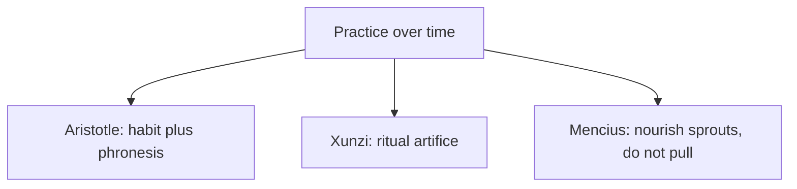

# Cultivation and habit

**Prerequisites:** [The mean](the-mean.md) or [human nature](human-nature-xing.md)

*Bust of Aristotle. Marble, Roman copy after a Greek bronze original by Lysippos from 330 BC; the alabaster mantle is a modern addition. Credit: After Lysippos. License: Public domain. Source: [File:Aristotle Altemps Inv8575.jpg](https://commons.wikimedia.org/wiki/File:Aristotle_Altemps_Inv8575.jpg).*
[Aristotle](../../history/ancient/greek/thinkers/aristotle.md) and the Confucians, especially [Xunzi](../../history/ancient/chinese/thinkers/xunzi.md), share a first-principles bet: you become good by doing, under guidance, until a disposition is yours. Aristotle's virtues are acquired by habit; *phronesis* still has to see the case. Xunzi's ritual and teaching straighten a raw nature as a frame straightens a board. [Mencius](../../history/ancient/chinese/thinkers/mencius.md) insists that something is already there to nourish, and warns against pulling the sprouts. [Zhu Xi](../../history/imperial/chinese/thinkers/zhu-xi.md) and [Wang Yangming](../../history/imperial/chinese/thinkers/wang-yangming.md) later fight about the starting place of the same work of cultivation.

The comparison is not "East and West agree." It is that two traditions made **practice over time**, not a single insight or a single law, central to ethics — and then disagreed about nature, ritual, and habit's exact role.

## Working the idea

Both Greek and Chinese ethics are, at root, arts of becoming a certain kind of person, not only arts of choosing the right act once. Aristotle's claim that ethical virtue arises by *ethos*, habit, is the Greek version of this. We become just by doing just acts, in the same way a builder becomes a builder by building — with the crucial difference that the beginner's act is not yet the virtuous person's act. The beginner does the just thing as the teacher or the law directs; the virtuous person does it as the just would, from a stable character, for the sake of the fine, and with pleasure rather than struggle. Habit is the bridge. It is also the danger: a badly brought-up person is habituated too, and Aristotle is frank that some characters are already hard to argue with.

Confucian self-cultivation (*xiushen*) is a cousin, not a translation. The student of the *Analects* and of the later *Great Learning* works through ritual, music, correction of names, reflection, and the imitation of models. The point is not a single "habit loop." It is a lifelong shaping of the heart-mind in roles — son, friend, minister, teacher — so that the right response becomes timely and sincere. Xunzi, especially, makes the analogy with craft and with straightened wood almost Aristotle-like in its stress on artifice, though the rites and the Sage-kings are his instruments, not the Greek polis' legislation alone.

A practical way to use the idea is to ask, of any ethical text, what it thinks is *trainable* and what would count as evidence that training has worked. If the answer is only "try harder to choose rightly," the text is not yet talking about character. If the answer is a practice — music, fasting, dialectic, a rule of life, a community of friends — then you have found the engine. Keep "habit" from shrinking into a modern psychological trick; in these traditions it is how a nature, or a second nature, is formed.

## Key ideas

- Character is formed by guided practice, in both Aristotle and Confucianism.
- Habit, ritual, and nourishing sprouts are different pictures of that practice.
- Knowing, for both traditions, is usually not enough on its own.

## Where this leads

- [Virtue as knowledge](virtue-as-knowledge.md), [ren and li](ren-and-li.md)
- Texts: [*Nicomachean Ethics*](../../history/ancient/greek/texts/nicomachean-ethics.md), [*Xunzi*](../../history/ancient/chinese/texts/xunzi.md)
