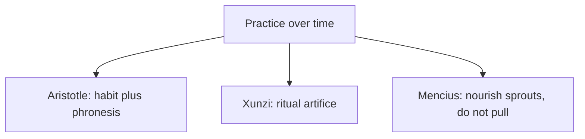

# Cultivation and habit

**Prerequisites:** [The mean](the-mean.md) or [human nature](human-nature-xing.md)

[Aristotle](../../history/ancient/greek/thinkers/aristotle.md) and the Confucians, especially [Xunzi](../../history/ancient/chinese/thinkers/xunzi.md), share a first-principles bet: you become good by doing, under guidance, until a disposition is yours. Aristotle's virtues are acquired by habit; *phronesis* still has to see the case. Xunzi's ritual and teaching straighten a raw nature as a frame straightens a board. [Mencius](../../history/ancient/chinese/thinkers/mencius.md) insists that something is already there to nourish, and warns against pulling the sprouts. [Zhu Xi](../../history/imperial/chinese/thinkers/zhu-xi.md) and [Wang Yangming](../../history/imperial/chinese/thinkers/wang-yangming.md) later fight about the starting place of the same work of cultivation.

The comparison is not "East and West agree." It is that two traditions made **practice over time**, not a single insight or a single law, central to ethics — and then disagreed about nature, ritual, and habit's exact role.

## Key ideas

- Character is formed by guided practice, in both Aristotle and Confucianism.
- Habit, ritual, and nourishing sprouts are different pictures of that practice.
- Knowing, for both traditions, is usually not enough on its own.

## Where this leads

- [Virtue as knowledge](virtue-as-knowledge.md), [ren and li](ren-and-li.md)
- Texts: [*Nicomachean Ethics*](../../history/ancient/greek/texts/nicomachean-ethics.md), [*Xunzi*](../../history/ancient/chinese/texts/xunzi.md)
