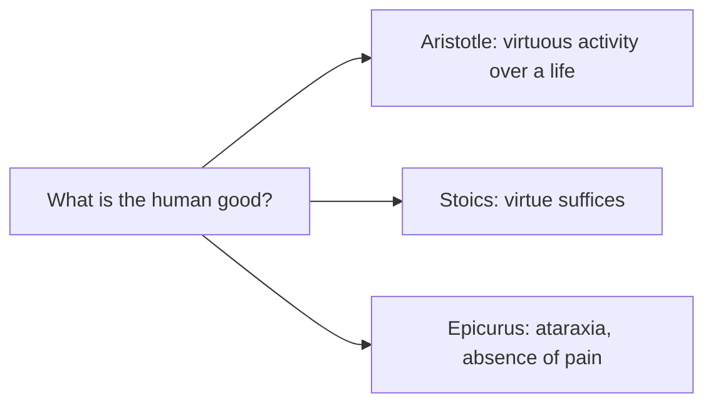

# *Eudaimonia*

**Prerequisites:** [Virtue and *arete*](virtue-and-arete.md) and the [*Nicomachean Ethics*](../../history/ancient/greek/texts/nicomachean-ethics.md)

*Bust of Aristotle. Marble, Roman copy after a Greek bronze original by Lysippos from 330 BC; the alabaster mantle is a modern addition. Credit: After Lysippos. License: Public domain. Source: [File:Aristotle Altemps Inv8575.jpg](https://commons.wikimedia.org/wiki/File:Aristotle_Altemps_Inv8575.jpg).*
*Eudaimonia* is the name, in [Aristotle](../../history/ancient/greek/thinkers/aristotle.md), for the human good: flourishing, living well over a complete life, not a mood of cheerfulness. It is activity of the soul in accordance with virtue (and, in Book X, especially with contemplation), in a life that also needs friends, some external goods, and a city. The [Stoics](../../history/ancient/greek/thinkers/zeno-of-citium.md) will later claim that virtue is sufficient for *eudaimonia*, so that externals are only preferred indifferents. [Epicurus](../../history/ancient/greek/thinkers/epicurus.md) will identify the good with a carefully understood pleasure, [*ataraxia*](ataraxia-and-apatheia.md).

The first-principles work is to ask what a human life is *for*, before asking about isolated acts or rules. That question is the opening of the *Ethics*, and it is close in spirit, if not in vocabulary, to Confucian questions about the *junzi*'s completed person.

## Working the idea

*Eudaimonia* is conventionally translated "happiness," and the translation keeps going wrong in the same way. Modern happiness often means a feeling, a mood, or a stretch of good luck. Aristotle's word is closer to **flourishing** or a **good life for a human being**, judged over a complete life, not over an afternoon. That is why a single stroke of fortune cannot settle the question, and why he can ask, seriously, whether a life can be called *eudaimōn* while it is still going, or only when it has, so to speak, finished its course.

The *Nicomachean Ethics* argues that *eudaimonia* is activity of the soul in accordance with virtue, and if there are several virtues, in accordance with the best and most complete. External goods (friends, a certain prosperity, health, decent birth) are not nothing — they are equipment and occasions — but they are not the substance of the good life. The precise mix is contested even inside the Aristotelian tradition: how much contemplation, how much political action, how much vulnerability to luck. Hellenistic schools harden the question. For the Stoics, virtue is sufficient for *eudaimonia*; for the Epicureans, the good life is a life of stable pleasure understood as the absence of pain and disturbance. They are all answering the same ancient question — what is a life for? — with different accounts of the human good.

When you meet the word, do two things. First, refuse the quick swap "happiness = feeling good." Second, ask what *activity* the author thinks a flourishing life consists in, and what can ruin it from outside. A life whose success can be destroyed by a tyrant and a life whose success cannot are not two versions of the same theory with a different mood. They are different pictures of what we are.

## Key ideas

- *Eudaimonia* is flourishing over a life, not a feeling.
- Aristotle, Stoics, and Epicureans disagree about its conditions.
- It is an ethics of a whole life, not only of acts.

## Where this leads

- [The mean](the-mean.md), [cultivation and habit](cultivation-and-habit.md)
- Text: [*Nicomachean Ethics*](../../history/ancient/greek/texts/nicomachean-ethics.md)
- Glossary: [*eudaimonia*](../../glossary/greek/eudaimonia.md)
