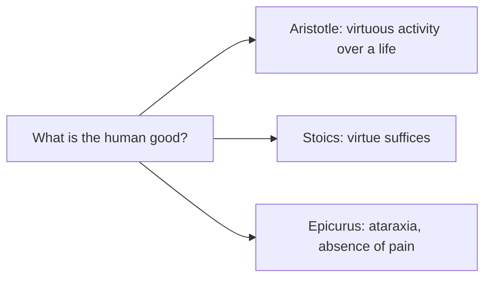

# *Eudaimonia*

**Prerequisites:** [Virtue and *arete*](virtue-and-arete.md) and the [*Nicomachean Ethics*](../../history/ancient/greek/texts/nicomachean-ethics.md)

*Eudaimonia* is the name, in [Aristotle](../../history/ancient/greek/thinkers/aristotle.md), for the human good: flourishing, living well over a complete life, not a mood of cheerfulness. It is activity of the soul in accordance with virtue (and, in Book X, especially with contemplation), in a life that also needs friends, some external goods, and a city. The [Stoics](../../history/ancient/greek/thinkers/zeno-of-citium.md) will later claim that virtue is sufficient for *eudaimonia*, so that externals are only preferred indifferents. [Epicurus](../../history/ancient/greek/thinkers/epicurus.md) will identify the good with a carefully understood pleasure, [*ataraxia*](ataraxia-and-apatheia.md).

The first-principles work is to ask what a human life is *for*, before asking about isolated acts or rules. That question is the opening of the *Ethics*, and it is close in spirit, if not in vocabulary, to Confucian questions about the *junzi*'s completed person.

## Key ideas

- *Eudaimonia* is flourishing over a life, not a feeling.
- Aristotle, Stoics, and Epicureans disagree about its conditions.
- It is an ethics of a whole life, not only of acts.

## Where this leads

- [The mean](the-mean.md), [cultivation and habit](cultivation-and-habit.md)
- Text: [*Nicomachean Ethics*](../../history/ancient/greek/texts/nicomachean-ethics.md)
- Glossary: [*eudaimonia*](../../glossary/greek/eudaimonia.md)
