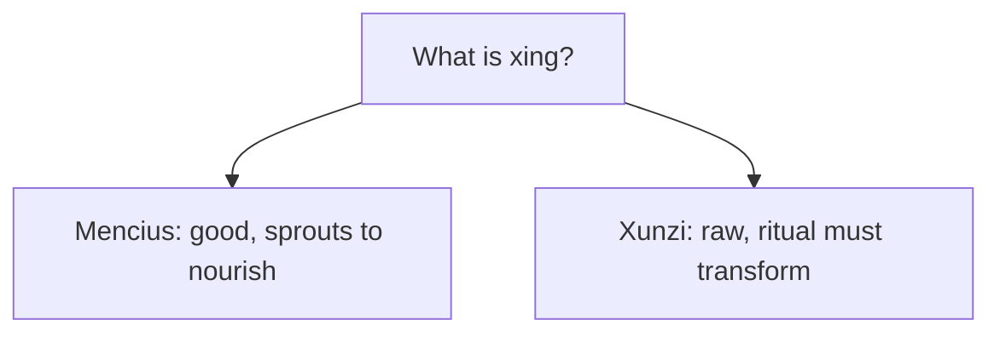

# Human nature (*xing*)

**Prerequisites:** [Mencius](../../history/ancient/chinese/thinkers/mencius.md) and [Xunzi](../../history/ancient/chinese/thinkers/xunzi.md)

The most important argument inside early Confucianism is about *xing*, human nature. [Mencius](../../history/ancient/chinese/thinkers/mencius.md) says it is good: virtue has native [sprouts](../../glossary/chinese/si-duan.md) that need nourishing, as the child-and-the-well shows. [Xunzi](../../history/ancient/chinese/thinkers/xunzi.md) says it is raw or bad: desire, left alone, yields disorder, and [ritual artifice](cultivation-and-habit.md) makes people good. Both are Confucians. Both care about education and government. They disagree about the starting point, and therefore about how much to trust moral feeling versus external form and standard.

The argument is a template still: if moral feeling is native, you have a reason to trust conscience and to limit coercion; if raw nature drifts, you emphasize training and institutions. Most serious ethics ends up borrowing from both.

## Key ideas

- Mencius and Xunzi split on *xing* while sharing a Confucian project.
- Sprouts versus artifice lead to different pedagogies and politics.
- The debate is more useful than any slogan that "the Chinese" believed nature was good.

## Where this leads

- [Ren and li](ren-and-li.md), [cultivation and habit](cultivation-and-habit.md)
- Texts: [*Mencius*](../../history/ancient/chinese/texts/mencius.md), [*Xunzi*](../../history/ancient/chinese/texts/xunzi.md)
