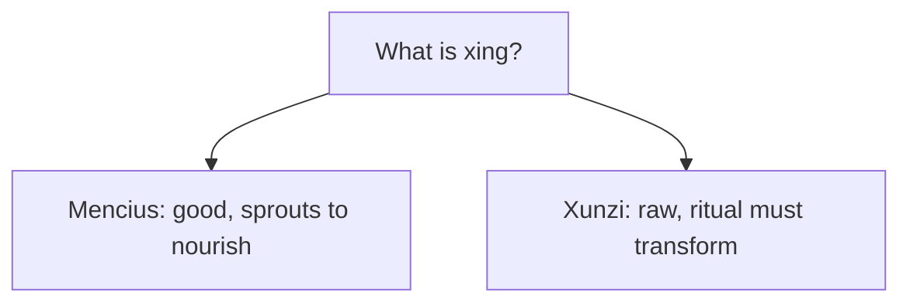

# Human nature (*xing*)

**Prerequisites:** [Mencius](../../history/ancient/chinese/thinkers/mencius.md) and [Xunzi](../../history/ancient/chinese/thinkers/xunzi.md)

*The teaching Confucius. Portrait by Wu Daozi, 685-758, Tang Dynasty. Credit: Wu Daozi, 685-758, Tang Dynasty.. License: Public domain. Source: [File:Confucius Tang Dynasty.jpg](https://commons.wikimedia.org/wiki/File:Confucius_Tang_Dynasty.jpg).*
The most important argument inside early Confucianism is about *xing*, human nature. [Mencius](../../history/ancient/chinese/thinkers/mencius.md) says it is good: virtue has native [sprouts](../../glossary/chinese/si-duan.md) that need nourishing, as the child-and-the-well shows. [Xunzi](../../history/ancient/chinese/thinkers/xunzi.md) says it is raw or bad: desire, left alone, yields disorder, and [ritual artifice](cultivation-and-habit.md) makes people good. Both are Confucians. Both care about education and government. They disagree about the starting point, and therefore about how much to trust moral feeling versus external form and standard.

The argument is a template still: if moral feeling is native, you have a reason to trust conscience and to limit coercion; if raw nature drifts, you emphasize training and institutions. Most serious ethics ends up borrowing from both.

## Working the idea

*Xing* is the pivot of a long Confucian argument about whether people are naturally good, naturally bad, or naturally neither, and therefore about what education and ritual are for. The term is not automatically "innate essence" in a later Western sense, and translators argue over how much metaphysics to load into it. In the debates that matter here, it names the native tendencies a person has before, or underneath, training.

Mencius' famous sprouts (*duan*) — compassion, shame, courtesy, and a sense of right and wrong — are offered as evidence that the heart-mind already inclines toward goodness, as a sprout inclines toward a plant. The thought-experiment of seeing a child about to fall into a well is meant to catch a reaction before calculation. Evil, on this view, is a matter of failing to nourish, of a bad environment, or of letting other desires starve the sprouts. Xunzi's contrary claim, that *xing* is raw and bad (or at least chaotic and self-seeking), does not celebrate cruelty. It raises the status of *wei*, artifice: ritual, law, teachers, and effort are what make a person good, as straight wood is steamed and bent. Both men are Confucians. They disagree about the starting point, not about the need for learning.

A careful reader should avoid two shortcuts. One is to turn the debate into a modern psychology poll ("are humans naturally good?"). The texts are doing moral pedagogy and, in Xunzi's case, a theory of ritual and language, not running an experiment. The other is to declare a winner before watching how each view changes the practice of study. If Mencius is right, education is nourishment and the recovery of a lost heart. If Xunzi is right, education is a long construction. When you later meet Gaozi in the *Mencius*, or Han Fei's much bleaker political psychology, place them on this same map rather than starting over.

## Key ideas

- Mencius and Xunzi split on *xing* while sharing a Confucian project.
- Sprouts versus artifice lead to different pedagogies and politics.
- The debate is more useful than any slogan that "the Chinese" believed nature was good.

## Where this leads

- [Ren and li](ren-and-li.md), [cultivation and habit](cultivation-and-habit.md)
- Texts: [*Mencius*](../../history/ancient/chinese/texts/mencius.md), [*Xunzi*](../../history/ancient/chinese/texts/xunzi.md)
