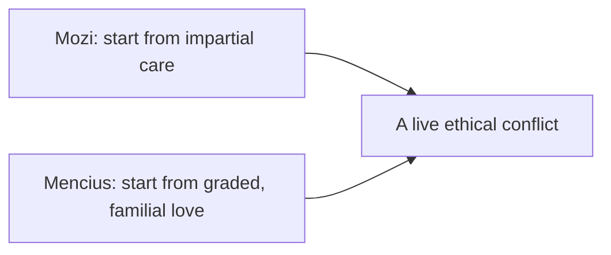

# Impartial care (*jian ai*)

**Prerequisites:** [Mozi](../../history/ancient/chinese/thinkers/mozi.md) and [ren and li](ren-and-li.md)

[Mozi](../../history/ancient/chinese/thinkers/mozi.md)'s signature doctrine is *jian ai*: impartial care, or "universal love" in an older English. Disorder comes from partiality — caring for my family and state in a way that licenses harm to yours. The remedy is to care for others' families and states as one's own, a standard Mozi also ties to [Heaven's will](../../glossary/chinese/tian.md) and to benefit for the world. [Mencius](../../history/ancient/chinese/thinkers/mencius.md) replies that this starts in the wrong place: love must be grown from filial feeling, or it becomes a slogan that undermines the family.

The argument is still live whenever someone asks how far "charity begins at home" may shrink the moral world, and whether impartiality is the first principle or an achievement of graded love.

## Key ideas

- Impartial care is Mohism's ethical first principle, tested by benefit and Heaven.
- Mencius attacks it as psychologically unrealistic and anti-familial.
- The debate is about where moral concern starts, not about whether others matter.

## Where this leads

- Texts: [*Mozi*](../../history/ancient/chinese/texts/mozi.md), [*Mencius*](../../history/ancient/chinese/texts/mencius.md)
- Glossary: [*jian-ai*](../../glossary/chinese/jian-ai.md)
