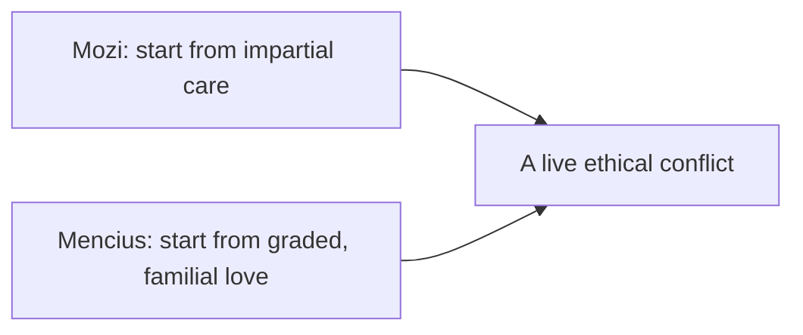

# Impartial care (*jian ai*)

**Prerequisites:** [Mozi](../../history/ancient/chinese/thinkers/mozi.md) and [ren and li](ren-and-li.md)

*The teaching Confucius. Portrait by Wu Daozi, 685-758, Tang Dynasty. Credit: Wu Daozi, 685-758, Tang Dynasty.. License: Public domain. Source: [File:Confucius Tang Dynasty.jpg](https://commons.wikimedia.org/wiki/File:Confucius_Tang_Dynasty.jpg).*
[Mozi](../../history/ancient/chinese/thinkers/mozi.md)'s signature doctrine is *jian ai*: impartial care, or "universal love" in an older English. Disorder comes from partiality — caring for my family and state in a way that licenses harm to yours. The remedy is to care for others' families and states as one's own, a standard Mozi also ties to [Heaven's will](../../glossary/chinese/tian.md) and to benefit for the world. [Mencius](../../history/ancient/chinese/thinkers/mencius.md) replies that this starts in the wrong place: love must be grown from filial feeling, or it becomes a slogan that undermines the family.

The argument is still live whenever someone asks how far "charity begins at home" may shrink the moral world, and whether impartiality is the first principle or an achievement of graded love.

## Working the idea

Mozi's *jian ai*, often translated "impartial care" or "inclusive concern," is a direct challenge to the graded loves of the Confucian household and state. The Mohist diagnosis is that partiality — caring for one's own house, city, and family *at the expense of others* — is the engine of war, robbery, and waste. The remedy is to care for other people's families as one cares for one's own, judged by the standard of *li* (benefit) and *hai* (harm) for the world under Heaven. Heaven itself, in the Mohist religious frame, wants this inclusive standard and will have it.

The argument is practical more than lyrical. Mozi asks whether a world in which people feed only their own would survive famine, and whether rulers who favor their own states can claim to love Heaven's people. Critics, from the Confucian side and from later readers of the *Mencius*, reply that love must start somewhere, that a man who loves another father's son exactly as his own has in fact dissolved the special duties that make filial piety and political loyalty possible, and that a thin, interchangeable concern will not actually motivate anyone. The Mohist can answer that graded love is being asked to *expand*, not to vanish, and that ritual expense (especially lavish funerals) should be measured by benefit rather than by grief's display.

Work the idea by refusing a cartoon. Impartial care is not modern utilitarianism, though later philosophers have compared them; the Mohist world still has Heaven, ghosts, and a tight interest in frugality, non-aggression, and worthy ministers. Nor is it simple coldness toward the family. The question the text forces is whether a moral and political order can be built on expanding concern by a common measure of benefit, or whether it must be built on role-specific loves that are, by design, not impartial. Read the Mohist essays first, then Mencius' objections, then decide what is at stake.

## Key ideas

- Impartial care is Mohism's ethical first principle, tested by benefit and Heaven.
- Mencius attacks it as psychologically unrealistic and anti-familial.
- The debate is about where moral concern starts, not about whether others matter.

## Where this leads

- Texts: [*Mozi*](../../history/ancient/chinese/texts/mozi.md), [*Mencius*](../../history/ancient/chinese/texts/mencius.md)
- Glossary: [*jian-ai*](../../glossary/chinese/jian-ai.md)
