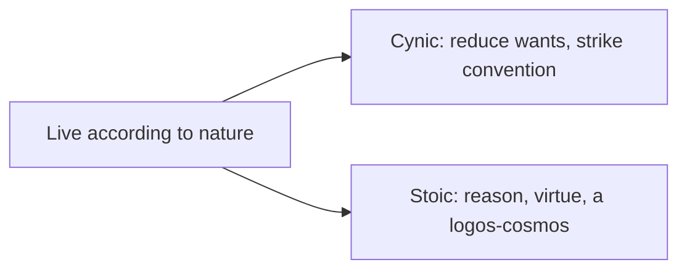

# Living according to nature

**Prerequisites:** [Zeno of Citium](../../history/ancient/greek/thinkers/zeno-of-citium.md) or [Diogenes and the Cynics](../../history/ancient/greek/thinkers/diogenes-and-the-cynics.md)

*Bust of Aristotle. Marble, Roman copy after a Greek bronze original by Lysippos from 330 BC; the alabaster mantle is a modern addition. Credit: After Lysippos. License: Public domain. Source: [File:Aristotle Altemps Inv8575.jpg](https://commons.wikimedia.org/wiki/File:Aristotle_Altemps_Inv8575.jpg).*
"Live according to nature" is a Cynic and then a Stoic slogan, and it changes meaning. For the [Cynics](../../history/ancient/greek/thinkers/diogenes-and-the-cynics.md), nature is often the hardy animal's needs, against *nomos* and luxury. For the [Stoics](../../history/ancient/greek/thinkers/zeno-of-citium.md), nature is a rational, providential [cosmos](../metaphysics/logos-as-account-and-order.md), and to live according to it is to live according to reason and to treat virtue as the only good. *Oikeiosis* explains how concern can extend from one's own constitution to the whole of humanity.

The slogan is therefore not a single ethics. It is a family of claims about what "nature" is. Always ask which nature is meant before taking the advice.

## Working the idea

"Live according to nature" is the most portable of Stoic slogans and one of the easiest to empty out. In Stoic hands it is not an invitation to follow every impulse, nor a Romantic appeal to forests and unspoiled feeling. Nature (*physis*) here is the rational order of the whole, of which the human being is a part. To live according to nature is to live according to reason, and to treat what befalls you — health, wealth, reputation, even the lives of those you love — as **preferred or dispreferred indifferents**, not as the good itself. The good is virtue, the excellent use of reason; everything else may be selected with care but must remain capable of being released.

That structure explains both the attraction and the offense of Stoicism. The attraction is a kind of invulnerability: if the good is in your governing power, then exile, poverty, and illness cannot, by themselves, ruin you. The offense is the apparent coldness of calling a child's life an indifferent. Serious Stoics (and careful readers such as those who work through Epictetus and Marcus) do not recommend indifference in the everyday sense of not caring. They recommend a love that does not make the cosmos answerable to one person's will. Whether that is psychologically possible, or morally right, is a fair question to keep open.

Epicurean "nature" is a different map. For Epicurus, living according to nature means understanding the limits of pleasure and desire, not conforming to a providential cosmos. The Cynic predecessor of the Stoics also said "nature," often meaning a drastic stripping of convention. So the slogan is a family of claims. When you meet it, ask: *whose* nature, *which* account of the world, and what happens to ordinary attachments on this view? The answer will not be the same in Zeno, in Epicurus, and in a modern self-help borrowing of the word "stoic."

## Key ideas

- The slogan is shared; the meaning of "nature" is not.
- Cynic nature is austere need; Stoic nature is a rational whole.
- Cosmopolitan concern is a Stoic development of the idea.

## Where this leads

- [The polis and the political animal](../political/the-polis-and-political-animal.md), [fa, shi, and shu](../political/fa-shi-shu.md) as a rival bet
- Glossary: [*physis*](../../glossary/greek/physis.md), [*oikeiosis*](../../glossary/greek/oikeiosis.md)
