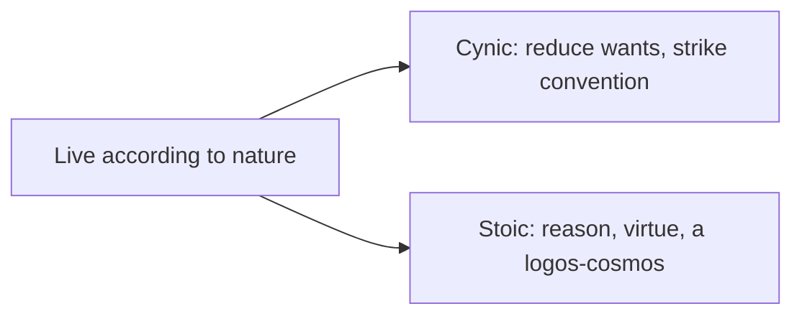

# Living according to nature

**Prerequisites:** [Zeno of Citium](../../history/ancient/greek/thinkers/zeno-of-citium.md) or [Diogenes and the Cynics](../../history/ancient/greek/thinkers/diogenes-and-the-cynics.md)

"Live according to nature" is a Cynic and then a Stoic slogan, and it changes meaning. For the [Cynics](../../history/ancient/greek/thinkers/diogenes-and-the-cynics.md), nature is often the hardy animal's needs, against *nomos* and luxury. For the [Stoics](../../history/ancient/greek/thinkers/zeno-of-citium.md), nature is a rational, providential [cosmos](../metaphysics/logos-as-account-and-order.md), and to live according to it is to live according to reason and to treat virtue as the only good. *Oikeiosis* explains how concern can extend from one's own constitution to the whole of humanity.

The slogan is therefore not a single ethics. It is a family of claims about what "nature" is. Always ask which nature is meant before taking the advice.

## Key ideas

- The slogan is shared; the meaning of "nature" is not.
- Cynic nature is austere need; Stoic nature is a rational whole.
- Cosmopolitan concern is a Stoic development of the idea.

## Where this leads

- [The polis and the political animal](../political/the-polis-and-political-animal.md), [fa, shi, and shu](../political/fa-shi-shu.md) as a rival bet
- Glossary: [*physis*](../../glossary/greek/physis.md), [*oikeiosis*](../../glossary/greek/oikeiosis.md)
