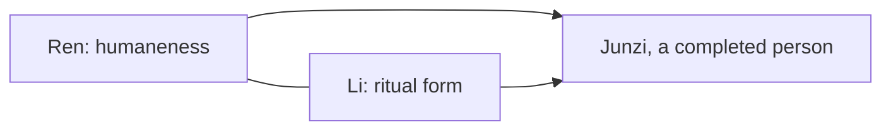

# *Ren* and *li*

**Prerequisites:** [Confucius](../../history/ancient/chinese/thinkers/confucius.md)

[*Ren*](../../glossary/chinese/ren.md) is the central Confucian virtue of a fully human life: cultivated humaneness, grown from family feeling and extended outward. [*Li*](../../glossary/chinese/li-ritual.md) is ritual, ceremony, and the inherited forms of appropriate conduct. In the [*Analects*](../../history/ancient/chinese/texts/analects.md) they are paired. Without *ren*, ritual is empty performance; without *li*, humaneness has no reliable shape. Form trains feeling. Filial piety (*xiao*) is the first school of this structure.

[Mencius](../../history/ancient/chinese/thinkers/mencius.md) will root *ren* in a native sprout of compassion; [Xunzi](../../history/ancient/chinese/thinkers/xunzi.md) will make *li* the artifice that civilizes a raw nature. [Mozi](../../history/ancient/chinese/thinkers/mozi.md) will attack lavish *li* and graded love. The pair is the Confucian first-principles engine: ethics as cultivation in form, not only as a rule or a calculation.

## Key ideas

- *Ren* and *li* need each other: feeling and form.
- Later Confucians keep the pair and disagree about nature and artifice.
- Mohist and Daoist critiques target one or both sides of the pair.

## Where this leads

- [Human nature](human-nature-xing.md), [cultivation and habit](cultivation-and-habit.md)
- Text: [*Analects*](../../history/ancient/chinese/texts/analects.md)
