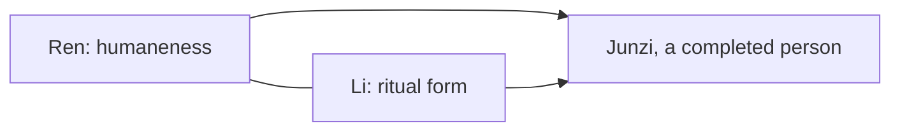

# *Ren* and *li*

**Prerequisites:** [Confucius](../../history/ancient/chinese/thinkers/confucius.md)

*The teaching Confucius. Portrait by Wu Daozi, 685-758, Tang Dynasty. Credit: Wu Daozi, 685-758, Tang Dynasty.. License: Public domain. Source: [File:Confucius Tang Dynasty.jpg](https://commons.wikimedia.org/wiki/File:Confucius_Tang_Dynasty.jpg).*
[*Ren*](../../glossary/chinese/ren.md) is the central Confucian virtue of a fully human life: cultivated humaneness, grown from family feeling and extended outward. [*Li*](../../glossary/chinese/li-ritual.md) is ritual, ceremony, and the inherited forms of appropriate conduct. In the [*Analects*](../../history/ancient/chinese/texts/analects.md) they are paired. Without *ren*, ritual is empty performance; without *li*, humaneness has no reliable shape. Form trains feeling. Filial piety (*xiao*) is the first school of this structure.

[Mencius](../../history/ancient/chinese/thinkers/mencius.md) will root *ren* in a native sprout of compassion; [Xunzi](../../history/ancient/chinese/thinkers/xunzi.md) will make *li* the artifice that civilizes a raw nature. [Mozi](../../history/ancient/chinese/thinkers/mozi.md) will attack lavish *li* and graded love. The pair is the Confucian first-principles engine: ethics as cultivation in form, not only as a rule or a calculation.

## Working the idea

*Ren* and *li* are often introduced as a pair of English words — "benevolence" and "ritual" — that make Confucius sound like a preacher of kindness plus etiquette. That flattening misses how the *Analects* uses them. *Li* is the inherited pattern of ceremony, mourning, court form, and everyday courtesy through which a person becomes recognizable as a member of a cultured community. It is not frosting on a moral cake. Without form, feeling has no trained way to appear. *Ren* is the achieved humaneness that makes the forms alive rather than hollow. Confucius can praise *li* and still despise mere punctiliousness: the rites without the person are a bronze vessel with no offering.

The productive tension is the point. Too much emphasis on *li* alone yields hypocrisy and rigidity, a charge later Mohists and some modern readers press. Too much emphasis on a vague inward kindness yields people who "mean well" and cannot conduct a funeral, serve in office, or honor a parent in a way the community can share. The *Analects* keeps sending the student back to practice: learning, correction, music, the right use of names, the model of the gentleman (*junzi*). *Ren* is not a hidden inner light that makes ritual optional. It is something you see in how a person inhabits the forms.

Later Confucians will systematize this pair in different directions. Mencius leans into the sprouts of moral feeling that ritual should nourish. Xunzi leans into ritual as artifice that civilizes a raw nature. You do not need those later systems to start. Read a few clusters of *Analects* passages on mourning, on filiality, and on the man who "loves *ren*" but not *li*, and ask, in each case, what would be lost if either term dropped out. Comparison with Greek *arete* and habit can wait until both pictures are independently clear.

## Key ideas

- *Ren* and *li* need each other: feeling and form.
- Later Confucians keep the pair and disagree about nature and artifice.
- Mohist and Daoist critiques target one or both sides of the pair.

## Where this leads

- [Human nature](human-nature-xing.md), [cultivation and habit](cultivation-and-habit.md)
- Text: [*Analects*](../../history/ancient/chinese/texts/analects.md)
