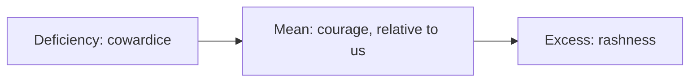

# The mean

**Prerequisites:** [*Eudaimonia*](eudaimonia.md)

In the [*Nicomachean Ethics*](../../history/ancient/greek/texts/nicomachean-ethics.md), ethical virtue is a **mean** between extremes, relative to us, and found by practical wisdom: courage between cowardice and rashness, generosity between stinginess and waste. The mean is not mediocrity and not a mathematical mid-point. It is hitting the right mark, which can be demanding. [Habit](cultivation-and-habit.md) trains the disposition; *phronesis* sees the particular case.

A distant cousin is the Confucian [*zhongyong*](../../glossary/chinese/zhong-yong.md), the "mean" or centrality of the [*Doctrine of the Mean*](../../history/ancient/chinese/texts/doctrine-of-the-mean.md) — a different theory, with a more cosmic register, not Aristotle in Chinese. Comparison should wait until both texts have been read.

## Key ideas

- Virtue is a mean between extremes, relative to the agent, seen by *phronesis*.
- It is not bland moderation; it is a right hit.
- *Zhongyong* is a cousin term, not a translation of Aristotle.

## Where this leads

- [Cultivation and habit](cultivation-and-habit.md)
- Text: [*Nicomachean Ethics*](../../history/ancient/greek/texts/nicomachean-ethics.md)
- Glossary: [*mesotes*](../../glossary/greek/mesotes.md)
