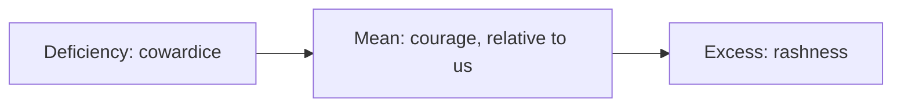

# The mean

**Prerequisites:** [*Eudaimonia*](eudaimonia.md)

*Bust of Aristotle. Marble, Roman copy after a Greek bronze original by Lysippos from 330 BC; the alabaster mantle is a modern addition. Credit: After Lysippos. License: Public domain. Source: [File:Aristotle Altemps Inv8575.jpg](https://commons.wikimedia.org/wiki/File:Aristotle_Altemps_Inv8575.jpg).*
In the [*Nicomachean Ethics*](../../history/ancient/greek/texts/nicomachean-ethics.md), ethical virtue is a **mean** between extremes, relative to us, and found by practical wisdom: courage between cowardice and rashness, generosity between stinginess and waste. The mean is not mediocrity and not a mathematical mid-point. It is hitting the right mark, which can be demanding. [Habit](cultivation-and-habit.md) trains the disposition; *phronesis* sees the particular case.

A distant cousin is the Confucian [*zhongyong*](../../glossary/chinese/zhong-yong.md), the "mean" or centrality of the [*Doctrine of the Mean*](../../history/ancient/chinese/texts/doctrine-of-the-mean.md) — a different theory, with a more cosmic register, not Aristotle in Chinese. Comparison should wait until both texts have been read.

## Working the idea

Aristotle's mean is easier to caricature than to use. A modern reader often hears "moderation in all things" and pictures a bland midpoint, as if courage were halfway between running away and charging blindly, measured on a single scale. That is not the claim. The *Nicomachean Ethics* treats the mean as **relative to us** and as the work of *phronesis*, practical wisdom that sees this agent, in this situation, with these risks. What is courageous for a trained soldier may be rash for someone unarmed; what is generous for one estate may be ruinous for another. The "right amount" is not a number in a table. It is a hit, more like an archer's mark than a compromise.

The structure is also not the same for every virtue. Some names (temperance, generosity, mildness) sit neatly between a named excess and a named deficiency. Others are grammatically awkward: there is no everyday word for every extreme, and some admirable acts (justice, in important stretches of the *Ethics*) do not behave like a mid-point on a feeling-scale at all. Aristotle knows this. The mean is a way of talking about getting the passions and actions *right* — at the right time, toward the right people, in the right way — not a machine for generating virtues.

Two further mistakes are worth blocking early. First, the mean is not a plea for lukewarm character. Proper anger, proper pride, and proper magnificence can be intense. The person of virtue is not the person who feels little; it is the person whose feeling is fitted to the case. Second, knowing the doctrine is not yet having the disposition. The mean is acquired by [habit](cultivation-and-habit.md), in a community that already has some models of the fine, and it is exercised in particulars. That is why Aristotle spends so much time on upbringing, friendship, and the city, and why a classroom summary of "the golden mean" can sound finished when the ethical work has barely started.

A comparison with the Confucian [*zhongyong*](../../glossary/chinese/zhong-yong.md) is tempting and should be postponed until both texts have been read. Both traditions care about hitting a right pitch rather than swinging between extremes. They do not share a metaphysics, a theory of the passions, or a political frame. Read Aristotle first as an account of Greek ethical training, then ask, carefully, what kind of cousin the Chinese term is.

## Key ideas

- Virtue is a mean between extremes, relative to the agent, seen by *phronesis*.
- It is not bland moderation; it is a right hit.
- *Zhongyong* is a cousin term, not a translation of Aristotle.

## Where this leads

- [Cultivation and habit](cultivation-and-habit.md)
- Text: [*Nicomachean Ethics*](../../history/ancient/greek/texts/nicomachean-ethics.md)
- Glossary: [*mesotes*](../../glossary/greek/mesotes.md)
