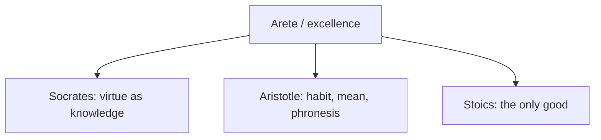

# Virtue and *arete*

**Prerequisites:** [What philosophy is](../../README.md)

*Arete* is often translated "virtue," and it also means excellence: the distinctive goodness of a thing at being what it is. A knife, a horse, and a human being can all have *arete*. In ethics, the question becomes what the excellence of a human life is. [Socrates](../../history/ancient/greek/thinkers/socrates.md) ties it closely to knowledge; [Aristotle](../../history/ancient/greek/thinkers/aristotle.md) to habituated dispositions of character and to [practical wisdom](../../glossary/greek/phronesis.md), aimed at [*eudaimonia*](eudaimonia.md); the [Stoics](../../history/ancient/greek/thinkers/zeno-of-citium.md) make virtue the only genuine good.

Chinese *De* and the Confucian virtues (*[ren](ren-and-li.md)*, *yi*, *li*, *zhi*) are not the same word, but they occupy related space: the excellence of a cultivated person, sometimes also a potency that transforms others. Comparison is useful after each tradition's terms are in view.

## Key ideas

- *Arete* is excellence, of which moral virtue is the human case.
- Greek schools disagree on whether virtue is knowledge, habit, or the only good.
- Chinese *De* and *ren* are cousins, not synonyms.

## Where this leads

- [Eudaimonia](eudaimonia.md), [the mean](the-mean.md), [virtue as knowledge](virtue-as-knowledge.md)
- Glossary: [*arete*](../../glossary/greek/arete.md), [*de*](../../glossary/chinese/de.md)
