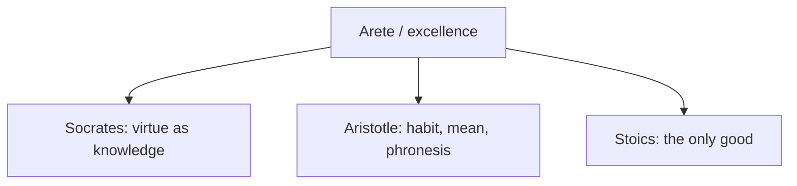

# Virtue and *arete*

**Prerequisites:** [What philosophy is](../../README.md)

*Bust of Aristotle. Marble, Roman copy after a Greek bronze original by Lysippos from 330 BC; the alabaster mantle is a modern addition. Credit: After Lysippos. License: Public domain. Source: [File:Aristotle Altemps Inv8575.jpg](https://commons.wikimedia.org/wiki/File:Aristotle_Altemps_Inv8575.jpg).*
*Arete* is often translated "virtue," and it also means excellence: the distinctive goodness of a thing at being what it is. A knife, a horse, and a human being can all have *arete*. In ethics, the question becomes what the excellence of a human life is. [Socrates](../../history/ancient/greek/thinkers/socrates.md) ties it closely to knowledge; [Aristotle](../../history/ancient/greek/thinkers/aristotle.md) to habituated dispositions of character and to [practical wisdom](../../glossary/greek/phronesis.md), aimed at [*eudaimonia*](eudaimonia.md); the [Stoics](../../history/ancient/greek/thinkers/zeno-of-citium.md) make virtue the only genuine good.

Chinese *De* and the Confucian virtues (*[ren](ren-and-li.md)*, *yi*, *li*, *zhi*) are not the same word, but they occupy related space: the excellence of a cultivated person, sometimes also a potency that transforms others. Comparison is useful after each tradition's terms are in view.

## Working the idea

*Arete* is older and wider than the English word "virtue," which has picked up a tone of prim moral respectability. In Greek it is excellence at being the kind of thing one is: a sharp knife has *arete*, a good eye has *arete*, and a human being's *arete* is the excellence of a rational, social creature. When Socrates asks whether virtue can be taught, or Aristotle asks how ethical virtue is acquired, they are not first of all asking how to be "nice." They are asking how a human life gets to be a good specimen of its kind.

That width is useful and dangerous. It is useful because it keeps ethics close to a picture of function and flourishing, not a list of prohibitions. It is dangerous because it can hide disagreements about *what* the human function is, and because the excellences admired in a Homeric warrior are not simply the excellences of Aristotle's *phronimos* or of a Christian saint. When you meet the word in a translation, check whether the context is martial, civic, intellectual, or ethical, and whether the author is stretching an older term into a new theory.

Plato and Aristotle both inherit the word and reshape it. Plato, in different dialogues, ties it to knowledge, to the order of the soul, and to the forms. Aristotle divides intellectual and ethical virtue, makes ethical virtue a habit sitting in a mean, and insists that the complete life needs friends and a certain stretch of external goods as well. Hellenistic schools will narrow or relocate the good until virtue (for the Stoics) becomes sufficient for happiness. None of this is visible if *arete* is flattened into "being virtuous" in a modern Sunday sense. Keep the Greek word close at hand, and let each school tell you what excellence would actually look like in a person.

## Key ideas

- *Arete* is excellence, of which moral virtue is the human case.
- Greek schools disagree on whether virtue is knowledge, habit, or the only good.
- Chinese *De* and *ren* are cousins, not synonyms.

## Where this leads

- [Eudaimonia](eudaimonia.md), [the mean](the-mean.md), [virtue as knowledge](virtue-as-knowledge.md)
- Glossary: [*arete*](../../glossary/greek/arete.md), [*de*](../../glossary/chinese/de.md)
