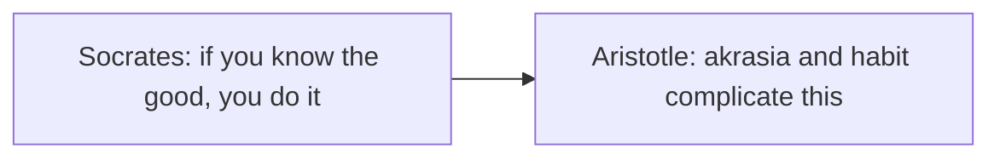

# Virtue as knowledge

**Prerequisites:** [Socrates](../../history/ancient/greek/thinkers/socrates.md) and [elenchus and aporia](../epistemology/elenchus-and-aporia.md)

A thesis closely associated with [Socrates](../../history/ancient/greek/thinkers/socrates.md) is that **virtue is a kind of knowledge**: if you really understood the good, you would not willingly choose the bad. Wrongdoing is ignorance, not a second power in the soul. This explains why definition matters ethically, and why the *elenchus* is a moral practice. The [*Protagoras*](../../history/ancient/greek/texts/protagoras.md) and [*Meno*](../../history/ancient/greek/texts/meno.md) turn around this claim and around the teachability of virtue.

[Aristotle](../../history/ancient/greek/thinkers/aristotle.md) pushes back with [*akrasia*](../../glossary/greek/akrasia.md): people sometimes act against their better judgment, and character is a matter of habit, not of insight alone. The argument is still live whenever someone says "they should have known better" and someone else says "knowing is not enough."

## Key ideas

- Socratic ethics ties virtue tightly to knowledge of the good.
- That thesis makes inquiry a moral task and wrongdoing a form of ignorance.
- Aristotle's *akrasia* is the classic complication.

## Where this leads

- [Cultivation and habit](cultivation-and-habit.md)
- Texts: [*Protagoras*](../../history/ancient/greek/texts/protagoras.md), [*Nicomachean Ethics*](../../history/ancient/greek/texts/nicomachean-ethics.md)
