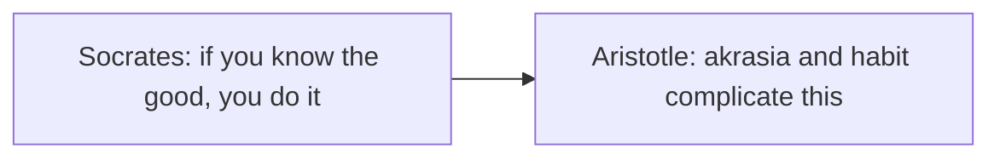

# Virtue as knowledge

**Prerequisites:** [Socrates](../../history/ancient/greek/thinkers/socrates.md) and [elenchus and aporia](../epistemology/elenchus-and-aporia.md)

*Bust of Aristotle. Marble, Roman copy after a Greek bronze original by Lysippos from 330 BC; the alabaster mantle is a modern addition. Credit: After Lysippos. License: Public domain. Source: [File:Aristotle Altemps Inv8575.jpg](https://commons.wikimedia.org/wiki/File:Aristotle_Altemps_Inv8575.jpg).*
A thesis closely associated with [Socrates](../../history/ancient/greek/thinkers/socrates.md) is that **virtue is a kind of knowledge**: if you really understood the good, you would not willingly choose the bad. Wrongdoing is ignorance, not a second power in the soul. This explains why definition matters ethically, and why the *elenchus* is a moral practice. The [*Protagoras*](../../history/ancient/greek/texts/protagoras.md) and [*Meno*](../../history/ancient/greek/texts/meno.md) turn around this claim and around the teachability of virtue.

[Aristotle](../../history/ancient/greek/thinkers/aristotle.md) pushes back with [*akrasia*](../../glossary/greek/akrasia.md): people sometimes act against their better judgment, and character is a matter of habit, not of insight alone. The argument is still live whenever someone says "they should have known better" and someone else says "knowing is not enough."

## Working the idea

The Socratic claim that virtue is knowledge is easy to hear as a schoolmaster's overstatement: if you really knew what was good, you would do it, so all wrongdoing is ignorance. Plato's early dialogues put the thought under pressure rather than simply preaching it. In the *Protagoras*, Socrates argues that no one willingly chooses the worse, and that what looks like being overcome by pleasure is a failure to measure. In the *Meno* and *Gorgias*, the same family of ideas meets resistance: can virtue be taught? is justice a kind of expertise? what sort of knowledge would it be?

A useful way to work the idea is to ask what "knowledge" would have to be for the claim to have a chance. If knowledge is only the ability to recite a definition, the claim is obviously false: people recite "justice is giving each his due" and still cheat. Socrates is after something more like a stable, teachable grasp that reorganizes desire, a knowledge that cannot sit unused in the way a fact about the date of a battle can. That is why *akrasia* (weakness of will, knowing the better and doing the worse) is the standing objection. Aristotle later insists that such failure is real, and that habit and appetite can outrun a merely verbal grasp. A Socratic reply, or a Platonic development, is that the so-called knower who fails did not yet know in the required sense.

The claim is also political. If virtue is a kind of expertise, the city might hope to teach it, and the Sophists' offer to teach "excellence" becomes a rival. If it cannot be taught in that way, upbringing, love, and dialectic take the place of a handbook. When you read the early dialogues, keep both the moral psychology and the teaching problem in view. The slogan is a start; the argument is in the dramatic pressure Plato puts on it.

## Key ideas

- Socratic ethics ties virtue tightly to knowledge of the good.
- That thesis makes inquiry a moral task and wrongdoing a form of ignorance.
- Aristotle's *akrasia* is the classic complication.

## Where this leads

- [Cultivation and habit](cultivation-and-habit.md)
- Texts: [*Protagoras*](../../history/ancient/greek/texts/protagoras.md), [*Nicomachean Ethics*](../../history/ancient/greek/texts/nicomachean-ethics.md)
