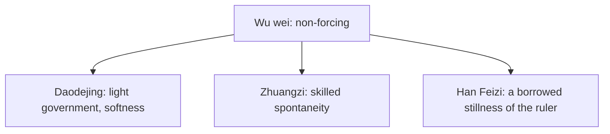

# *Wu wei*

**Prerequisites:** [Dao as way and source](../metaphysics/dao-as-way-and-source.md)

*Wu wei* is often translated "non-action," which sounds like passivity. "Non-forcing" or "non-contrivance" is closer. In the [*Daodejing*](../../history/ancient/chinese/texts/daodejing.md) it is a way of ruling and living that does not fight the grain of things: fewer prohibitions, less moral advertising, a potency like water finding a course. In the [*Zhuangzi*](../../history/ancient/chinese/texts/zhuangzi.md) it appears as **skillful spontaneity**: Cook Ding's knife moves through the spaces after long practice, not as laziness and not as a theory imposed on the ox.

[Han Feizi](../../history/ancient/chinese/thinkers/han-feizi.md) can borrow the language of the ruler's stillness and fill it with legal machinery — a reminder that the phrase, like *Dao*, can travel. The first-principles question is always: non-forcing *as opposed to what*, and in the service of what life or what state?

## Key ideas

- *Wu wei* is non-forcing, not simple inaction.
- Laozi and Zhuangzi develop it as politics and as skill; Legalism can appropriate the word.
- Always ask what is not being forced, and why.

## Where this leads

- Thinkers: [Laozi](../../history/ancient/chinese/thinkers/laozi.md), [Zhuangzi](../../history/ancient/chinese/thinkers/zhuangzi.md)
- Glossary: [*wu-wei*](../../glossary/chinese/wu-wei.md), [*ziran*](../../glossary/chinese/ziran.md)
